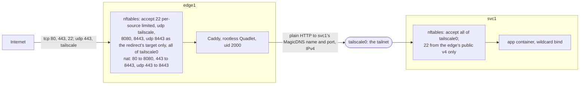
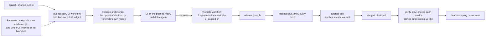
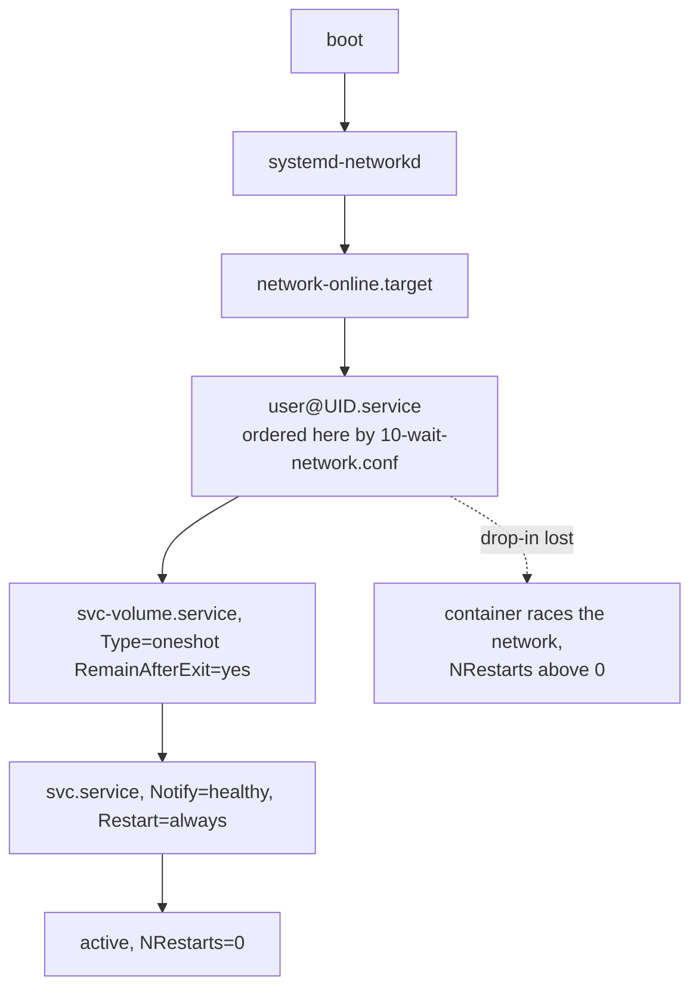
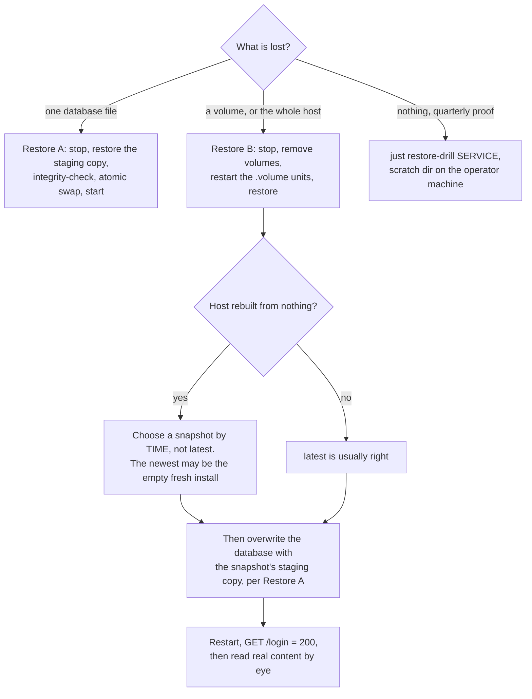

<!-- SPDX-License-Identifier: CC-BY-4.0 -->
<!-- SPDX-FileCopyrightText: 2026 Aryan Ameri <info@ameri.me> -->

# deerlab runbook

- Two Debian 13 VPSs, Ansible only. `edge1` runs Caddy; `svc1` runs each application as a rootless Podman Quadlet under its own system user; the edge reaches svc1 over a Tailscale tailnet; delivery by `ansible-pull` from the `release` branch
- Written for someone holding only this repository, under time pressure, with nobody to ask: it records what is silent when it goes wrong
- Read [What is not proven](#what-is-not-proven) before trusting any procedure here in a real disaster
- `<svc>` is a service name, which is also its username; `<uid>` is its uid. Substitute `<placeholders>` and `{{ inventory_variable }}` from the decrypted inventory, and never paste a real value back into this file
- Addresses, ports, accounts, buckets, endpoints and credentials are encrypted in the inventory. The public domains and their hostnames are encrypted too — `deerlab_domain` for most services, `vikunja_hostname` for Vikunja and `actual_hostname` for Actual — but a public CA publishes every issued hostname to Certificate Transparency: indirection, not secrecy. Never build a control on them being hidden

## Contents

[Before you can do anything](#before-you-can-do-anything) ·
[The shape of the estate](#the-shape-of-the-estate) ·
[Where everything lives on a host](#where-everything-lives-on-a-host) ·
[Delivery](#delivery) · [Tailscale](#tailscale) ·
[Reading state on a host](#reading-state-on-a-host) ·
[Reboots and planned maintenance](#reboots-and-planned-maintenance) ·
[Alerts, and what only looks like a fault](#alerts-and-what-only-looks-like-a-fault) ·
[Verification after a deploy](#verification-after-a-deploy) ·
[Backups](#backups) · [Restore](#restore) ·
[Rebuilding a host from nothing](#rebuilding-a-host-from-nothing) ·
[Bootstrapping a host](#bootstrapping-a-host) · [Adding a service](#adding-a-service) ·
[Vikunja](#vikunja) · [Actual](#actual) · [RSSHub](#rsshub) ·
[Rotating a secret](#rotating-a-secret) ·
[SSH from a machine with several keys](#ssh-from-a-machine-with-several-keys) ·
[Break-glass](#break-glass) · [What is not proven](#what-is-not-proven)

## Before you can do anything

- Neither of the two below is **in this repository or recoverable from it**. A rebuild is impossible without the first and unsafe without the second

### The SOPS age identity

- Recipients in `.sops.yaml`: the operator key, plus one per host that `base_pull` generates on the host itself
- The operator identity is never on disk: the login shell exports `SOPS_AGE_KEY_CMD` and `sops` runs it on every decryption. A process that does not inherit it cannot decrypt — export it inline in front of the command, never write a key file
- **Operator machine:** never set `SOPS_AGE_KEY_FILE`, never create `~/.config/sops/age/keys.txt`. `sops` checks the file variable *before* the command variable, so a stray key file silently retires the vault route and puts the identity back on disk
- **Hosts: the opposite, by design.** No vault and no interactive shell there, so `deerlab-pull.service` sets `Environment=SOPS_AGE_KEY_FILE=/etc/deerlab/age.key` — 0400, generated on the host at bootstrap. Every host must be a `.sops.yaml` recipient before its first unattended pull can decrypt
- `sops`, `ansible` or `just` **hanging** rather than failing means the vault is locked. A hang is not a decryption error
- Losing the identity loses the configuration secrets permanently: the host keys decrypt `inventory/` but live on the hosts being rebuilt, and `secrets/` is encrypted to the operator key alone

### The object store's version-retention window

- Every `*.sops.yaml` under `inventory/` is encrypted to **both** host keys. The edge's Caddyfile reads `hostvars['svc1']` and `base_firewall` on svc1 reads the edge's, forcing each host to compute the peer's whole variable set, so a host that cannot decrypt the other's vars cannot parse the inventory at all
- Both hosts therefore hold every service's restic password and object-store keys, and the ciphertext is in a public repository besides. **Assume a compromise of either host reaches every service's repository**
- Prefix scoping is real — one service's key is refused at the `Stat` of another's repository config object — but it buys no per-host blast radius
- Those credentials can delete, and must: `restic backup` takes and releases a lock under `locks/` on every run
- The only thing between a compromised host and erased history is that **the object store retains prior versions of deleted objects for a fixed window**. Set at the provider, recorded nowhere here, verified by nothing in the estate
- It is a *detection deadline*, not immutability: it buys time for the dead-man checks to notice. **Backup alerts silent for longer than that window mean the history may already be gone.** Look the window up before you need it
- `secrets/backup-admin.sops.yaml` holds the operator's full-access object-store credential, encrypted to the operator key alone, never given to a host — so a host compromise cannot reach the credential that erases everything

## The shape of the estate



| | edge host `edge1` | services host `svc1` |
| --- | --- | --- |
| Groups | `edge`, `podman_hosts` | `services`, `podman_hosts` |
| Public inbound | tcp 22, limited per source, 80, 443; udp 443, 41641 (Tailscale). 8080, 8443 and udp 8443 only as the target of the 80/443 redirect | tcp 22, **from the edge's public v4 only** |
| Tailnet inbound | everything on `tailscale0`; the [tailnet policy](#the-tailnet-policy) decides what reaches it | everything on `tailscale0`; the [tailnet policy](#the-tailnet-policy) decides what reaches it |
| Runs | sshd, Caddy, the [DNS forwarder](#the-services-dns-forwarder) | sshd, application services, the [DNS forwarder](#the-services-dns-forwarder) |
| Service users | Caddy's, uid 2000, and the forwarder's, 2001 | one per application, uid from 2001, and the forwarder's, 2008 |

- Stock Debian 13, dual-stack on the public side, `base_*` roles only; nothing installed by hand. **Ansible is the only executor** — no hypervisor, no OpenTofu, no orchestrator. The one control plane outside the repository is Tailscale's, for the tailnet
- Host ports 80/443 reach Caddy through an nftables redirect to 8080/8443. Caddy still listens on 80 and 443 inside its namespace, so its own redirects and ACME challenges work unchanged
- **The edge reaches the services host over the tailnet** ([Tailscale](#tailscale)). Caddy proxies plain HTTP to svc1's MagicDNS name over IPv4, because Actual listens on IPv4 only, and asks quad-100 for the name; the tailnet's own WireGuard encryption supplies confidentiality and integrity, its machine keys authenticate the peers, and the [policy](#the-tailnet-policy) decides what each may reach
- The edge serves more than one registrable domain: most sites are hostnames under `deerlab_domain`, and Vikunja and Actual have their own, `vikunja_hostname` and `actual_hostname`. Every certificate comes from the same ACME account, so a new domain needs only DNS records pointing at the edge, plus, if the domain publishes a CAA record, one that allows the CA
- Backends publish on the wildcard address, never on an interface's own address — a unit binding an address that only appears once an interface is up races it at boot and fails hard on Podman 5.4.2. **The bind address does not scope a backend: the [policy](#the-tailnet-policy) does, granting the edge 8080–8099 on svc1 and the operator's devices every port**
- One `podman_services` entry derives the service user, its 65536-wide subordinate ID range, its firewall egress chain, its slice limits, its Quadlet units, its Podman secrets, and, where it has a `backup:` block, its backup unit and timer
- **Subordinate ID ranges are arithmetic, not allocated:** `podman_user_subid_base + (uid - podman_user_uid_base) * podman_user_subid_count`, from `roles/podman_user/templates/subid.j2`. A rebuilt host derives the same mapping from the same inventory, which is what makes a restore portable
- Corollary, and a live hazard: **changing a service's `uid`, or `podman_user_uid_base` / `podman_user_subid_base` / `podman_user_subid_count`, silently invalidates the file ownership recorded in every existing snapshot for that service**

## Where everything lives on a host

| Thing | Path |
| --- | --- |
| Pull unit and timer | `/etc/systemd/system/deerlab-pull.{service,timer}` |
| Pull checkout | `/var/lib/deerlab/checkout` |
| Pull's Ansible virtualenv | `/opt/deerlab/venv` |
| Host's age identity | `/etc/deerlab/age.key` (0400 root) |
| Pushover credential, system scope | `/etc/deerlab/pushover.conf` |
| Pushover credential, per service user | `/etc/deerlab/pushover/<svc>.conf` |
| Quadlet units | `/etc/containers/systemd/users/<uid>/` |
| Service home | `/var/lib/<svc>` (0700) |
| Service config files | `/var/lib/<svc>/config/` |
| Podman volumes | `/var/lib/<svc>/.local/share/containers/storage/volumes/<svc>-<volume>/_data` |
| Backup env, password, dead-man conf | `/etc/deerlab/backup/<svc>.env`, `.password`, `-deadman.conf` |
| Backup bootstrap marker | `/etc/deerlab/backup/<svc>.initialised` |
| Backup unit and timer | `/etc/systemd/user/deerlab-backup-<svc>.{service,timer}` |
| Job timers | `/etc/systemd/user/<svc>-<job>.timer`; the job's container is a Quadlet like the rest |
| SQLite staging copy | `/var/lib/<svc>/backup/staging/` |
| User-manager ordering drop-in | `/etc/systemd/system/user@<uid>.service.d/10-wait-network.conf` |
| Per-service slice limits | `/etc/systemd/system/user-<uid>.slice.d/50-deerlab.conf` |
| Firewall ruleset | `/etc/nftables.conf` |

- Quadlet units are `root:root` 0644: the service user reads its unit, never rewrites it
- The bare `/etc/containers/systemd/users/` directory is never used; a unit placed there runs under *every* lingering user

## Delivery



| Recipe | Effect |
| --- | --- |
| `just ci` | the lint pipeline locally. CI runs it, and the [CI lab](#the-ci-lab) for each host, on every PR to `main` and every push to `main`, and Promote ships only a commit CI passed on a push to `main` |
| `just plan HOST` | check-and-diff `site.yml` against a real host |
| `just apply HOST` | push directly; bootstrap and break-glass only |
| `just bootstrap HOST` | first run on a fresh image, as root, pull timer held off; asks for a one-off Tailscale auth key and joins the tailnet |
| `just enrol HOST` | join a running host to the tailnet with a one-off auth key ([Tailscale](#enrolling-a-host)) |
| `just ssh HOST [ARGS]` | a shell on a host, or ARGS run there: the edge directly, every other host through the edge over the tailnet ([SSH](#ssh-from-a-machine-with-several-keys)) |
| `just idempotency HOST` | apply twice, fail if the second run changed anything |
| `just verify HOST` | run every check of every service against the host now; pages nobody, records nothing ([Verification](#verification-after-a-deploy)) |
| `just secrets-edit FILE`, `just secrets-rekey` | edit, or re-encrypt for the current recipients |
| `just backup-prune SVC`, `just restore-drill SVC` | one argument, the service name |

- Timer: `OnCalendar=*:0/30`, `RandomizedDelaySec=300`, `Persistent=true`. It checks out `release` and applies `site.yml --limit <itself>`, without checking the head commit's signature
- Pull sooner with `mise x -- ansible <host> -b -m ansible.builtin.shell -a 'systemctl start deerlab-pull.service'`
- `Promote` fast-forwards `release` to the commit CI passed on, not to whatever `main` points at when it runs, and only for a **push** to `main`. It is the only workflow that pushes `release`
- CI on `main` runs one commit at a time and never cancels a run in progress, so each merge is shipped in turn. A newer push replaces only a run still waiting, and Promote skips that one; the next run ships both. On a PR, a new push cancels the run it supersedes
- **Promote's manual run** ships a named commit on `main` without waiting for CI: `gh workflow run promote.yml --ref main -f sha=<full sha>`. It refuses anything but a full 40-character SHA that `main` contains, and a run dispatched from any other branch. It still only fast-forwards. Use it only in a recovery you are already doing by hand: the revert of a migrating service after a restore, which the lab can never pass ([Rolling back](#the-backup-before-an-image-switch)), or an urgent fix that should not wait for the lab while a `just apply` would be undone by the next pull
- **Accepted risk: write access to the repository is root on both hosts.** Whatever `release` points at is applied as root within about 35 minutes, and nothing pages when it changes. Anyone who can move it can do this: the operator's account, the Renovate App's private key (a repository secret that any workflow run from this repository can read, and the App holds `contents: write` and `workflows: write`), any workflow token with `contents: write` (Promote's `GITHUB_TOKEN` and Renovate's App token included), and any action running inside such a workflow. There are no branch rules, by choice
- **`just plan` reports exactly one change on a converged host**: `base_pull : Install Ansible into its virtual environment`, because `ansible.builtin.pip` cannot tell whether requirements are satisfied without invoking pip, which check mode forbids. **Anything beyond that one change is real drift**
- **`just plan` requires an already-bootstrapped host.** `podman_service` runs `podman info` as each service user, and that user does not exist until a real run has created it. Check mode against a fresh image fails; use `just bootstrap`
- **Collections are pinned exactly** in `requirements.yml`, and `deps.yml` installs every pin into the checkout's `collections/`, ignoring the copies the `ansible` pip package bundles. A pull loads its collections before `deps.yml` runs, so a collection bump takes effect on the **second pull after promotion**. `just plan` never installs them, because check mode skips the command: after a collection bump, run `just setup` before `just plan`
- **Each service user's image store keeps only the record's image.** After a service's units are written and it has restarted, `podman_service` removes that user's other images. An image a container still uses is left for a later pull. A revert pulls the old digest from the registry again; if the registry no longer has it, that pull fails before anything of the service is rewritten, and the service keeps running. Under `--check` the removal is reported, not made

### Bot pull requests

- **Renovate** runs in GitHub Actions (`.github/workflows/renovate.yml`) every 3 hours (at 17 past, Sydney time), after every push to `main`, and whenever CI finishes on one of its `renovate/**` branches, on a token minted per run from a GitHub App. GitHub starts scheduled runs hours late, so the schedule is a heartbeat; the other two triggers do the work. The App is installed on this repository only and holds these repository permissions: Contents, Pull requests, Issues, Commit statuses and Workflows, all read and write, plus Metadata read. The minted token is narrowed to the same five
- **The App's private key is a repository secret** (`RENOVATE_APP_PRIVATE_KEY`, with `RENOVATE_APP_CLIENT_ID` beside it). Any workflow run in this repository can read it, including runs on branches and pull requests from this repository. Because the App holds `contents: write` and `workflows: write`, whoever holds the key can push to `main`, and so to `release`, and so run code as root on both hosts. There are no branch rules, by choice. A minted token holds `workflows: write`, so within its hour it can push a workflow that reads `RENOVATE_APP_PRIVATE_KEY`, which turns one hour of access into the long-lived key. The key is a repository secret by the operator's choice: an environment secret limited to `main` would keep it from branch and pull request runs, but not from a push straight to `main`
- Renovate opens one PR per dependency, at any time and for every update type, majors included. `ansible` and `sops` each get a single PR covering both files that pin them. The cooldowns hold a release back after it is published: Docker Hub images 3 days; PyPI, Galaxy, the Actions and GitHub releases (the hosts' sops and Tailscale, and the mise tools) 7 days; none where the registry gives no time (ghcr.io, Actual, RSSHub). The Dependency Dashboard issue is a record of what is pending; nothing waits there for a tick
- **Renovate merges its own PR** once every check on it has finished green, `Lint and validate`, `Lab svc1` and `Lab edge1` among them, while the repository variable `DEERLAB_AUTOMERGE` is `enabled`. It merges through the API with "Rebase and merge", one PR per run; the run that CI finishing starts merges the next one, and the push rebases the rest. A cancelled, timed-out or never-finished check leaves the PR waiting, as a failure does. GitHub's own auto-merge stays off: without required checks it could merge before the tests ran, outside the switch
- **Stopping it:** `gh variable set DEERLAB_AUTOMERGE --body disabled`, or `gh variable delete DEERLAB_AUTOMERGE`. The switch fails closed: unset, empty or any value but `enabled` stops merging (GitHub compares it without regard to case). It acts from the next Renovate run and cannot recall a merge already made. Resume with `gh variable set DEERLAB_AUTOMERGE --body enabled`. While it is off, Renovate still opens and rebases PRs, and their PR bodies say "Automerge: Disabled by config"
- **An update you reverted waits for you.** Renovate proposes it again, but switches automerge off for an update whose earlier PR was merged. Close that PR to keep the version out, or merge it by hand once its cause is fixed
- **The stall check** (`.github/workflows/stall.yml`) runs daily at 08:23 Sydney time and fails, so GitHub notifies you, when any of these holds. Each step names what it found:
  - a Renovate PR open more than 14 days: an update that never ages past its cooldown, such as a Docker Hub tag rebuilt more often than every 3 days
  - a Renovate PR red or pending for more than 24 hours since its last push, `renovate/stability-days` aside: a failed check, or a cancelled, timed-out or stuck one
  - no successful Renovate run in 24 hours: Renovate or its token is broken, and nothing else would say so
  - `main` ahead of `release` by a commit older than 24 hours: CI red on `main`, or Promote failing
- A scheduled workflow's failure is mailed to whoever last changed its cron line. Settings, Notifications, Actions must be on
- Renovate also manages the pinned GitHub Actions, holding each release back 7 days. Every action stays pinned by commit SHA, with its version beside it. Dependabot is not used. If a Renovate bump of `actions/create-github-app-token` or `renovatebot/github-action` breaks token minting or the run, Renovate cannot open its own fix: revert that bump by hand, as a normal PR with "Rebase and merge"
- Renovate's PRs run CI without anyone approving them. After each push to `main`, Renovate rebases the PRs that are now behind it, and an open PR can move to a newer release at any time
- **Landing one by hand**, while the switch is off, and for your own PRs and an agent's, which never merge themselves:
  1. Read the PR and its notes. A Vikunja or Actual bump is backed up by the host itself before it switches image ([Backups](#backups)), and the lab has already run that migration on its own data. A Baikal bump cannot be undone. An image bump's capability list is proven only as far as the lab and the [checks](#verification-after-a-deploy) reach
  2. Read the merge box before you click. No check is required, so the button works on a red or pending PR, and a green PR was tested against `main` as it was when the PR was last updated
  3. Click "Rebase and merge", then watch Promote
- GitHub turns off a scheduled workflow after 60 days with no repository activity. If the Dependency Dashboard issue stops updating, look at the Actions tab

### The CI lab

- **What it is.** Job `lab` in `.github/workflows/ci.yml`, once per host, as checks `Lab svc1` and `Lab edge1`, on every PR and every push to `main`. A privileged Debian 13 container with systemd as PID 1, built on every run, stands in for the host, so its own Podman 5.4.2 runs every service rootless under its real user, slice, Quadlet units, firewall and egress class. It runs every service on every run, with no selector
- **What it runs**, as a host's pull does:
  1. **The base**: the PR's base commit, or for a push to `main` the commit `release` points at, with this commit's `ci/` laid over it, deployed with a venv built from the base's own `host-requirements.txt`. Retried once, for Vikunja's first-boot migration race; the base is code already in production. Nothing after it is retried
  2. **The change, on the old stack**: `ansible-pull` of the change with the base's venv, as a host's first pull of a new commit. Image switches fire the [backup gate](#the-backup-before-an-image-switch) for real, the new images migrate the base's data, and the verify play runs every check marked `both` or `ci`
  3. **The new stack**: the same pull again, on the venv and collections step 2 installed. It must change nothing
  4. **The dry run**: `--check --diff`, which must report exactly one change, the pip task, as `just plan` does
  5. Always: the lab's journal and every service user's units go to the job log
- **What it is not.** `ci/deploy.yml` leaves out what a container cannot run: `base_dns`, whose resolver the lab's image lacks, `base_os` beyond its kernel parameters, and `base_ssh`. `base_tailscale` runs from `ci/deploy.yml` only where the commit being deployed has the role, so an older base still deploys. It installs the pinned package and starts tailscaled in userspace networking, sending no logs to Tailscale, and never enrols. The head side upgrades the base's Tailscale in place, and the firewall restarts tailscaled when the change alters the ruleset. Userspace networking never exercises netfilter mode `on`, and nothing in the lab exercises tailnet traffic. The kernel parameters do apply, through `base_os`'s `sysctl` entry point, less three `net.core` keys a container's network namespace lacks, on the runner's kernel rather than Debian 13's. The lab's data is minutes old. See [What is not proven](#what-is-not-proven)
- **Stand-ins.** `ci/inventory/` is the real group and host vars, symlinked, plus `overrides.yml` files and the plaintext stand-ins in `ci/stand-ins/`, in documentation ranges and `example.test`, never a real value. Each run encrypts them with sops to an age key generated inside the lab, so the sops vars plugin is exercised for real. **A new key in any `secrets.sops.yaml` needs a stand-in in `ci/stand-ins/` with the same name, or the lab goes red**
- **Fixtures.** On a Docker network in 203.0.113.0/24, which no egress class treats as private, so the service users reach them through the real firewall: a throwaway rclone S3 server, which receives every backup the lab takes; a Caddy front with its own internal CA, which the lab trusts and which also answers the dead-man stand-in; and a dnsdist stand-in for the operator's DNS resolver behind the front (`ci/fixture/dnsdist.yml`), which answers the [forwarder](#the-services-dns-forwarder)'s DNS-over-HTTPS. It gives each service's probe name an address of its own, so the forwarder's `listeners-ci` check proves each listener leaves under its own service's name. The lab replaces Docker's resolver with the runner's upstream, because `base_firewall`'s `flush ruleset` deletes the rules Docker's own depends on. The presence query is off in the lab only (`backup_presence_query_enabled`), and Caddy issues from its internal CA (`caddy_local_certs`)
- **Running it locally.** Follow the steps of the `lab` job by hand on a Docker host, keeping every object named `deerlab-lab-*`, and pass `--skip-tags kernel` to `ansible-pull`, because the kernel play would set the Docker host's own kernel parameters. On arm64, RSSHub's image ships Playwright's Chromium for amd64 only, so its browser check needs `CHROMIUM_EXECUTABLE_PATH=/usr/bin/chromium` in the lab's copy of its record
- **A flaked lab run is re-run by hand:** `gh run rerun <run id> --failed`. Nothing else re-runs it on a Renovate PR until `main` moves, and on `main` a re-run of the push's own run is what lets Promote ship it; a new `gh workflow run ci.yml` does not, because Promote follows pushes only
- The lab's images are pinned in `LAB_*_IMAGE` in the job's `env:`, and Renovate bumps them like any other image. Debian's majors are disabled, because the hosts run Debian 13

## Tailscale

- **The tailnet is the operator's own**, created by hand in Tailscale's admin console, with MagicDNS on. Its DNS name (`tail<hex>.ts.net`), its 100.x addresses and the operator's login are identifiers: they never go in this repository
- **The edge reaches the services host over the tailnet.** Caddy's upstreams dial svc1's MagicDNS name, and Ansible and `just ssh` reach every host but the edge through the edge, with `ssh -W` to the host's MagicDNS name. Each host's MagicDNS name is `deerlab_tailnet_fqdn`, built from the tailnet's own name, `deerlab_tailnet_domain`, in SOPS. The WireGuard tunnel the hosts used before is gone
- **svc1 has one public door: SSH from the edge's public address.** Its only other public answers are ICMP's. A services host that has left the tailnet is reached through it: `just enrol` takes that route (`deerlab_ssh_route=public`), and so can any Ansible run, `just apply svc1 --extra-vars deerlab_ssh_route=public`. **The provider offers no console**, so this door and svc1's own pull are the only ways back in when the tailnet fails
- **Every pull checks the tailnet** (`tailnet_check`, the last play of every pull). On each host tailscaled must be `Running`; on the edge, every other host's SSH port must also answer at its MagicDNS name. A failure fails the pull, which pages `deerlab-pull.service failed on <host>`. The pull's journal names the cause, `tailscaled on <host> is <state>, not Running` or `the edge cannot reach <host>'s port 22 over the tailnet`: `journalctl -u deerlab-pull.service --since -2h -o cat --no-pager | grep -E 'not Running|over the tailnet'`. SSH rather than each backend, because backends restart during svc1's own pulls and would page falsely, while SSH proves the tailnet, the policy's grant and svc1's firewall at once. Caddy's site checks cover the backends only after each Caddy start, so between Caddy starts nothing pages for a backend the edge cannot reach while SSH still answers, as after a policy edit that loses 8080–8099. The CI lab turns the check off, because its tailscaled never joins
- **On each host**, `base_tailscale` installs the `tailscale` package from Tailscale's stable trixie repository at the version in `roles/base_tailscale/defaults/main.yml`, and holds it there. Renovate bumps that version after its 7-day cooldown ([Bot pull requests](#bot-pull-requests)), and reverting a bump installs the older version again. Tailscale's own updater is off, and the hold keeps apt from moving it
- **tailscaled reads its settings from `/etc/tailscale/tailscaled.json`, locked**: the inventory name as the machine name, MagicDNS accepted, other machines' routes refused, netfilter mode `on`, auto-update off. On the host, `tailscale set` and `tailscale up` are refused (`config file is locked`); change a setting in the role
- **`/etc/tailscale/authkey` must exist, even empty.** The config file names it, and tailscaled refuses to start while it is missing (`error reading config file authKey`). It is empty except during an enrolment
- **Every lookup on both hosts outside the tailnet's own names goes through tailscaled to the operator's DNS resolver.** The console's DNS settings name that resolver as the global nameserver with "Override DNS servers" on, and the hosts accept the tailnet's DNS, so tailscaled takes all of systemd-resolved's queries (`~.` on `tailscale0`), the service users' included, and sends them to the resolver over DNS-over-HTTPS. It answers the tailnet's names and its 100.x reverse lookups itself. The resolver sees every other lookup the servers make, with each one's machine name and tailnet address
- **A hung tailscaled, or the resolver down or blocking a name, stops DNS on that host** with no fallback: pulls, image pulls, certificate renewals, backups and the Pushover alerts fail together. The dead-man monitors still notice the silence. A fix pushed to `release` cannot arrive while a host's DNS is down, because its pull cannot resolve GitHub: reach svc1 through the edge's public path instead ([Break-glass](#break-glass)). If tailscaled crashes or stops, `tailscale0` goes away and the host's own servers, the resolver over DNS-over-TLS, take over again ([The hosts' resolver](#the-hosts-resolver))
- **The resolver's profile must not block what the hosts need.** Above all `*.tailscale.com`: a blocked answer for the control plane can take a host off the tailnet, and tailscaled's own fallback does not cover it ([tailscale/tailscale#14947](https://github.com/tailscale/tailscale/issues/14947)). Then GitHub, the container registries, the object store and the alert endpoint
- **The firewall accepts everything that arrives on `tailscale0`**: the tailnet policy decides what reaches each port. Each reload of the ruleset is followed by a tailscaled restart ([Expected, not incidents](#expected-not-incidents))

### The hosts' resolver

- **`base_dns` gives systemd-resolved global servers of its own: the operator's DNS resolver over DNS-over-TLS**, in `/etc/systemd/resolved.conf.d/50-deerlab.conf`. Its addresses (`deerlab_dns_tls_addresses`, two IPv4 and two IPv6) and the name on its certificate (`deerlab_dns_tls_name`) are in SOPS. The role puts the inventory name in front of that name (`<host>-<name>`), so the resolver's logs name the host on this path too
- **These servers answer only while tailscaled is not routing DNS**: before a host is enrolled, during each tailscaled restart, and after it crashes or stops. Once tailscaled routes (`~.` on `tailscale0`), every lookup goes through it as above, and these servers sit idle. The drop-in has no `Domains=~.` on purpose: that would send every lookup down both paths
- **Strict**, `DNSOverTLS=yes`: a server that cannot complete TLS with a certificate valid for the name gets no query, in plain text or otherwise. `FallbackDNS=` is empty, and LLMNR is off, so single-label names are not multicast on eth0
- **The provider's DHCP resolvers are kept out.** They complete DNS-over-TLS too, with certificates for their own addresses (both hosts', checked 2026-11-05), so while tailscaled was not routing they took about half the hosts' DNS-over-TLS traffic. A drop-in beside the provider's generated network file, `/etc/systemd/network/<file>.d/50-deerlab-dns.conf`, sets `UseDNS=no` for DHCPv4, DHCPv6 and router advertisements, and an empty `DNS=` clears any static servers the file lists, so eth0 hands resolved no servers. The network file itself is left as the image wrote it. The role reads the file's name from networkd on every run, so a rename is followed, and fails on an uplink networkd does not manage. It writes this drop-in only after the resolver's own servers are in place, and applies it with a reload, which keeps the DHCP lease and open connections; `networkctl reconfigure` would drop the address first (both measured on systemd 257). Every pull checks that eth0 hands resolved no servers, and reloads networkd while it still does, so a run that died before its reload is finished by the next. A container keeps the servers it started with: one started before this drop-in lists the provider's resolvers in its `resolv.conf` until it next starts
- **It fails closed.** If the resolver cannot be reached on port 853 while tailscaled is not routing, every lookup fails, and pulls, image pulls and the Pushover alerts fail together. The dead-man monitors are what notice
- **A changed drop-in is tested before it is written.** Each address must complete a TLS handshake with a certificate valid for the name, from the host's CAs. Otherwise the run fails with `the resolver at <address> did not complete a verified TLS handshake for the configured name on port 853`, and the host keeps its current DNS. A name the certificate covers passes, so a mistyped profile under the resolver's wildcard is not caught: only the resolver's own logs show a host under the wrong profile. Every run then looks up the repository's host, and fails if it cannot
- **The name is not encrypted.** The TLS handshake carries `<host>-<name>`, the resolver's profile included, in clear to anyone on the network path; the queries themselves are encrypted
- **What can still send DNS in plain text**, since no firewall rule blocks port 53:
  - A container's `resolv.conf` lists the host's upstream servers, the resolver's own addresses, after Podman's forwarder, and an image whose resolver asks them all at once sends plain queries to them. The egress classes drop UDP 53 to anything but the host's stub, but Caddy's class, `any`, accepts it all, and class `public` accepts TCP 53. A container started since its host joined the tailnet also carries `search <tailnet>`, so a name its resolver tries with the search domain appended, a dotless one at least, goes to those servers as `<name>.<tailnet>`, naming the tailnet
  - tailscaled asks a cloud's own resolver directly when its normal lookup fails, on the clouds it recognises
  - resolved, by its source, retries a query once over plain UDP if the resolver answers it with FORMERR or NOTIMP. Not seen here

### The services' DNS forwarder

- **Each host runs dnsdist, a DNS forwarder, as a service of its own**: `dnsdist`, uid 2008 on svc1 and 2001 on the edge, the first entry in each host's `podman_services`, so a fresh host starts it before any other service
- **It listens once for every other service on its host**, at `127.0.53.<uid - 1999>`, port 5300 (`deerlab_dns_listeners`, computed from the service records, so a new service gets a listener with no edit), and forwards each listener's queries over DNS-over-HTTPS to the operator's DNS resolver with the service's name in the request path. The resolver logs them under that name. The name and the resolver's profile travel inside TLS, unlike the hosts' own DNS-over-TLS name
- **Nothing sends it queries yet** but its own checks: every service still resolves through its host, as above
- **Its config is written from the same SOPS keys as `base_dns`**: `deerlab_dns_tls_name` gives the profile and the resolver's host name, and `deerlab_dns_tls_addresses` one backend each. It therefore holds the profile, and is a sensitive config file, `/var/lib/dnsdist/config/dnsdist.yml`, which no log and no diff shows. dnsdist 2.1 refuses an unknown key or a bad type at start, so a mistyped setting stops the forwarder rather than switching a check off
- **It fails closed.** No pool holds a plain-DNS server, and a pool whose backends are all down answers SERVFAIL. Each backend is checked once at start, then once queries fail, then every 10 s while it is down, so a forwarder whose upstream was unreachable answers again within about 10 s of its return, and SERVFAIL until then. Each check is a lookup of the resolver's own host name under that backend's service. A backend that fails while still marked up leaves queries unanswered until the checks mark it down
- **Any local source may ask.** The listeners bind loopback alone, and the kernel drops a packet from off the host addressed to 127/8, so the access list admits every address: a lookup a service first sent off the host keeps the host's own address as its source
- **How it runs.** In the host's network namespace, as in-container root, which on the host is its own unprivileged user with every capability dropped, so its traffic is under that user's egress chain, `platform`. That chain also accepts the forwarder's own listeners, which its health check and checks ask. `podman_service_check` refuses a host-network record with any other container user, whose sockets would belong to a subordinate uid that no egress chain filters. It trusts the host's CA bundle, mounted read-only, so Debian's CA updates reach it at the forwarder's next start, without an image bump
- **Its health check proves only that dnsdist answers**: a query to its own health listener, `127.0.53.254`, which a local rule answers. The `listeners` check, after every start, asks every listener for the resolver's own host name through the resolver: every listener reaches the resolver over verified DNS-over-HTTPS through the forwarder's egress chain. It does not prove the names; only the resolver's own record of a lookup does. Each service shows one such lookup at the resolver per forwarder start. `just verify HOST` runs it now
- **To ask a listener by hand**, as root on the host (root's lookups are never steered), for `example.com` through freshrss's listener; it prints the response code, `0` for an answer:
  `python3 -c 'import socket, sys; s = socket.socket(socket.AF_INET, socket.SOCK_DGRAM); s.settimeout(3); s.sendto(bytes.fromhex("5a5a01000001000000000000076578616d706c6503636f6d0000010001"), (sys.argv[1], 5300)); print(s.recv(512)[3] & 15)' 127.0.53.5`
- **The image's repository name pins dnsdist's 2.1 release line.** PowerDNS publishes each line as its own image (`powerdns/dnsdist-21`, then `-22`), so Renovate bumps 2.1's patch releases and digests and never proposes the next line. When 2.1 nears its end of life (PowerDNS's EOL page), move both `image:` in `inventory/group_vars/podman_hosts/main.yml` and `LAB_DNSDIST_IMAGE` in `.github/workflows/ci.yml` by hand. Nothing pages when a line stops getting fixes
- **A crash or a bad config** fails the unit and pages, and a start that fails fails the pull. A stop does not page: dnsdist exits 0 on `SIGTERM`

### Enrolling a host

1. In the console, generate an auth key: one-off, pre-approved, **not ephemeral**, expiring in a day, and tagged `tag:edge` for `edge1` or `tag:svc` for `svc1`. A tag applied at the machine's first login turns its key expiry off; a tag added later leaves the 180-day expiry on
2. `just enrol <host>`, and paste the key at the hidden prompt. It never goes on a command line: it travels in the Ansible run's environment on your machine, then as the content of a file copy, staged in the connecting user's temporary directory while that task runs, into the root-only `/etc/tailscale/authkey`. The run empties that file again whether or not the login worked; if the run is interrupted first, the host's next pull empties it
3. If the machine is not on the tailnet within a minute, the run fails with `tailscaled on <host> is <state>, not Running: <reason>`
4. The run then checks the machine's own view of itself: it must carry exactly its host's tag (`base_tailscale_tag`) and no key expiry. Otherwise it fails with `<host> joined as …`: delete the machine in the console and enrol it again with a correctly tagged key
5. A host already on the tailnet is left alone, its tag and expiry checked the same way, and the run says the key was not used

**A rebuilt host: delete its old machine in the console first.** Otherwise the new one joins under a de-duplicated MagicDNS name, `<host>.<tailnet>` still names the old, offline machine, and every site that reaches it is down while the host itself reports `Running`; only the edge's tailnet check fails

`just bootstrap` asks for a key the same way, and connects to the host directly, at its public address: a fresh host has no firewall yet. `just enrol` reaches a services host through the edge to its public address (`deerlab_ssh_route=public`), because a host being enrolled may not be on the tailnet

### The tailnet policy

- `tailscale/policy.hujson` is the whole policy. `.github/workflows/tailscale-policy.yml` pushes it after a merge to `main` that changes it, or when run by hand: `gh workflow run tailscale-policy.yml --ref main`
- **Every run waits for the operator's approval** in the `tailscale-policy` environment. The policy alone keeps the servers from opening connections to the operator's own devices, so anything that can push to `main`, which is already root on both hosts ([Delivery](#delivery)), can propose a policy but not push one
- The environment requires the operator's approval, allows deployments from `main` only, and lets no admin bypass either. It holds three secrets: `TS_OAUTH_CLIENT_ID` and `TS_AUDIENCE`, the ID and audience of the federated identity in the console (Settings, Trust credentials), and `TS_ADMIN_LOGIN`, the operator's login
- The federated identity trusts GitHub's OIDC tokens whose subject is `repo:aryonoco/deerlab:environment:tailscale-policy` and whose `repository_id` and `ref` claims are this repository's ID and `refs/heads/main`, so a run from any other branch is refused even once approved. Each run exchanges GitHub's token for a short-lived Tailscale one: no Tailscale secret is stored anywhere
- Its scopes are Policy File and DNS, read and write. The workflow uses only the policy file; DNS was granted for managing the tailnet's DNS from this repository later, and until then an approved run could change it
- The file holds `${TS_ADMIN_LOGIN}` where the login goes, and the run fills it in before pushing
- **Grants:** `group:admins`, the operator's login alone, reaches every port on both hosts; `tag:edge` reaches `tag:svc` on 22 and 8080–8099. Nothing else is granted, so neither host can open a connection to the operator's devices
- `cache-network-maps` lets a host restart from its cached map while Tailscale's control plane is down. It is a trial in 1.104; remove the `nodeAttrs` entry once caching is Tailscale's default
- **A tailnet with no policy allows everything.** Push the policy before the first host joins
- Tailscale runs the policy's `tests` on each push and refuses a policy that fails them. While no machine carries `tag:edge` or `tag:svc`, it may refuse tests that name them. Then paste the policy into the console without its `tests` block and with your login in place of the placeholder, enrol both hosts, and run the workflow by hand

## Reading state on a host

- No root SSH on either host: connect as `{{ deerlab_admin_user }}` (encrypted in `inventory/group_vars/all/`) and `sudo -i`. `ansible.cfg` sets `become = true` globally, so ad-hoc Ansible escalates without `-b`; the examples pass it anyway so they read correctly out of context

```sh
# Is a pull running? `systemctl is-active --quiet` LIES here - see below.
systemctl show deerlab-pull.service -p ActiveState --value
systemctl list-timers deerlab-pull.timer --no-pager

# Service state, from the system side
systemctl --user --machine=<svc>@ show <svc>.service \
  -p ActiveState -p SubState -p Result -p NRestarts

# Logs. `journalctl --machine=<svc>@` does NOT work: it attempts namespace
# entry. Match on the unit and uid instead.
journalctl _SYSTEMD_USER_UNIT=<svc>.service _UID=<uid> --since "-10 min" -o cat

# Anything run directly as the service user needs a working directory that user
# can reach. Run it from /, or runuser dies on `cannot chdir`.
cd / && runuser -u <svc> -- podman volume ls

# Compressed swap. Both hosts run zram sized at half of RAM, zstd, and NO disk
# swap. `swapon --show` shows the device; `zramctl` shows the compression
# actually achieved. A host under memory pressure now slows down instead of
# having a service OOM-killed - but zram buys time, not capacity.
swapon --show
zramctl
```

- **`just plan` cannot prove zram is running.** `systemd-zram-generator` is a generator: the swap unit is materialised by a daemon-reload reading `/etc/systemd/zram-generator.conf`, and under `--check` the generator has not run, so the unit that would be started does not exist and the task is skipped by design — not a failure, and nothing is left disabled, because the generator re-derives the unit from that file on every boot regardless. `swapon --show` on the real host is the only way to tell whether zram is actually up; a clean dry run proves nothing about it
- **`swapon --show` is not enough on its own — check `zramctl`.** The size and compression algorithm are applied by `systemd-zram-setup@` when the device is first set up and never re-read, so a device can be up and serving while running the generator's defaults (4 GB, lz4) rather than what `/etc/systemd/zram-generator.conf` asks for. That is how both hosts came up on their first run, and nothing reported it: swap was present and working, just not the swap that had been configured. `base_os` now restarts `dev-zram0.swap` when that file changes, but a device already wrong stays wrong until something restarts it

- **`systemctl is-active --quiet deerlab-pull.service` is wrong and will mislead you.** A `Type=oneshot` unit that is *running* is `activating`, not `active`, so `is-active` exits non-zero and you conclude nothing is running while a pull is in flight. This exact mistake caused a service to be restarted underneath an operator mid-drill. Always `systemctl show deerlab-pull.service -p ActiveState --value`; `inactive` or `failed` means done
- A healthy pull takes roughly 90 seconds, bounded by `TimeoutStartSec=20m`. The 0–300s randomised delay means two consecutive firings can land 25 minutes apart, not a clean 30
- **The pull is a live hazard during any manual intervention**, and there is no safe way to suppress it: stopping the timer is self-trapping, because only a pull re-enables it. Mitigate procedurally — check `ActiveState`, confirm the timer has headroom, work in the window straight after a pull completes

## Reboots and planned maintenance

- Automatic reboots are off; a daily timer posts `Reboot required on <host>` to Pushover for as long as `/run/reboot-required` exists



- Order: **services host first, then the edge**

```sh
mise x -- ansible svc1 -b -m ansible.builtin.reboot
mise x -- ansible svc1 -b -m ansible.builtin.shell \
  -a 'systemctl --user --machine=<svc>@ is-active <svc>.service'
mise x -- ansible edge1 -b -m ansible.builtin.reboot
```

- **Services host:** back in about a minute. The unit is `activating` immediately and reaches `active` 30–60s later; `NRestarts` stays `0`. Non-zero `NRestarts` means the wait-network drop-in has been lost and the unit is racing the network at boot. The services wait for the network, not the tailnet, so the sites fail until tailscaled is `Running` on both hosts
- **Edge host:** not measured since the sites moved to the tailnet. The sites answer once Caddy is up and tailscaled on both hosts is `Running`
- **Minutes of `503 no upstreams available` after either host reboots mean Caddy cannot reach svc1 over the tailnet.** Check `tailscale status` on both hosts, each `Running` and seeing the other, then the edge's pull journal for the tailnet check's message ([Tailscale](#tailscale))

## Alerts, and what only looks like a fault

- Two channels, sharing no failure domain
- **Nothing watches the external monitor itself**

| Channel | Reports | Wired by |
| --- | --- | --- |
| Pushover, direct from each host | a unit that **failed** | `OnFailure=` on every Quadlet, every backup unit, the pull unit, and `base_notify_onfailure_units` (`nftables.service`, `systemd-networkd.service`, `tailscaled.service`); the reboot-required timer posts the same way |
| Dead-man push monitors, on an external uptime monitor | a host that **stopped running anything** | `ExecStartPost` curl on each successful pull and each successful backup, tried four times 30 s apart on any error; a ping still failing after that fails the unit and pages |

- Notifications leave the host directly and depend on neither the edge nor the external monitor: an outage of the thing that watches must not silence the thing that reports
- Push URLs are bearer secrets, in SOPS as `deerlab_deadman_urls`. Anyone holding one can mark a check healthy and mask a real outage
- **A crash pages even when the service comes back by itself.** A primary or worker Quadlet restarts 5 s after a crash (`Restart=always`), but systemd fires `OnFailure=` on the failure first (`RestartMode=normal`), so a crash sends one alert, and so does a start that fails, including one whose volume unit failed. One alert followed by a healthy unit is a crash that recovered: read the journal. The alert per crash and per failed start was measured in a systemd 257 / Podman 5.4.2 lab
- **A failed check after a deploy sends two pages, once per start.** The verify play, at the end of every pull, runs the [checks](#verification-after-a-deploy) of each service that started since its last verdict. If any fails, it posts one Pushover message, `verify failed on <host>: <svc>/<check> (<detail>)`, naming every failed check, then fails the pull, whose `OnFailure=` sends the generic page as well. It records the verdict, so later pulls stay quiet until that service next starts
- **Each failing unit has a budget of three pages an hour.** Every unit that fails starts its own `notify-failure@<unit>.service` (for Actual, `notify-failure@actual.service.service`), and the template lets each instance start three times in an hour, counted from its first start (`StartLimitBurst=3`, `StartLimitIntervalSec=1h`). A failure past that is not paged: the instance is left `failed` with `start-limit-hit`, and its own journal says `notify-failure@<unit>.service: Start request repeated too quickly.` The failing unit's journal cannot tell a dropped page from a sent one: both show `Triggering OnFailure= dependencies.` The budget refills an hour after that instance's first page, and `systemctl reset-failed` on the instance refills it at once. Every primary or worker Quadlet with a health check refills its own budget once it is healthy (`ExecStartPost=` in `roles/podman_service/templates/container.j2`), so deliberate stops, restores and restarts do not spend it; only failures with no healthy start between them are capped. A change to the notifier template alone reaches a service's units only when that service's user manager next reloads, at a pull that changes one of its units or at a reboot, because each instance stays loaded. Read it on the host with `journalctl _UID=<uid> USER_UNIT=notify-failure@<unit>.service` for a service's units, or `journalctl -u notify-failure@<unit>.service` for a system unit. A crash loop has one of two shapes, both measured on Actual in a systemd 257 / Podman 5.4.2 lab:
  - **A server that exits at start** is refused its sixth start inside five minutes by `StartLimitIntervalSec=300`, and ends `failed` after three pages, in about 30 s
  - **A server that starts but fails its health probe** never trips that limit. Each start waits out `TimeoutStartSec=` or the probe's retries, fails and restarts, about every two minutes for Actual. It pages three times in the first few minutes, and the budget allows three more once its hour has passed (proved with a shortened window), and so on until someone fixes it. Other services cycle at a pace set by their own start timeouts and probe settings
- **A job that stops running is reported by nothing.** Pushover hears only a run that *fails*, and no dead-man watches a job. A job timer left stopped after a [restore](#restore), or a job that exits 0 having done nothing, looks like health: every unit green, the data going stale
- **Never set `RemainAfterExit=yes` on a timer-activated job.** The general advice pairs it with `Type=oneshot`; here it is exactly wrong. The job stays in a started state after its first run and **every later timer activation is suppressed**. Nothing fails, no unit enters `failed`, `OnFailure=` never fires, the primary stays healthy, and the scheduled work simply stops, with no alert on either channel. `roles/podman_service/templates/container.j2` leaves it out on purpose. On the host, the job's unit reads `active` between runs instead of `inactive`

### Expected, not incidents

| Symptom | Why |
| --- | --- |
| Stopping any service except FreshRSS, Vikunja, Actual, RSSHub and the DNS forwarder leaves it `failed` and pages you | A primary or worker Quadlet carries `Restart=always`, and Podman exits non-zero on `SIGTERM`, so an explicit `systemctl --user stop` ends `ActiveState=failed` and trips `OnFailure=`. So does each restart the role makes, including an image bump's. Do not chase it. `Restart=always` does not resurrect after an explicit stop, so the stop holds. FreshRSS ends `inactive` on a stop (recorded at its deploy). Vikunja's record sets `stop_signal: SIGINT`, it shuts down cleanly and exits 0, and a stop ends `inactive` without a page. Actual and RSSHub exit 143 on `SIGTERM`, and their records set `success_exit_status: [143]`, so a stop ends `inactive` and neither a stop nor a restart pages (each measured in a systemd 257 / Podman 5.4.2 lab). The DNS forwarder ends `inactive` too: the forwarder exits 0 on `SIGTERM` |
| A `notify-failure@<unit>.service` instance `failed` with `start-limit-hit` | `<unit>` failed more than three times within the hour counted from the instance's first page, and the pages after the third were dropped. Deal with `<unit>` itself: a primary or worker with a health check refills its budget at its next healthy start. For a backup unit, a job or a worker without one, `systemctl reset-failed notify-failure@<unit>.service` refills it at once, with `--user --machine=<svc>@` for a service's own units; otherwise it refills an hour after the instance's first page |
| An occasional HTTP 500 `database is locked` from Vikunja | Two writes overlapped. On 2.6.0 Vikunja opens a deferred SQLite transaction, and upgrading it to a write fails at once instead of waiting. Accepted, not worked around (spec 2026-09-24); the client shows an error and the user retries, and a CalDAV client retries at its next sync. A burst of them, or one that keeps recurring, is not this |
| One alert as Vikunja starts for the first time or after an upgrade, then `active` about 5 s later | Its health probe runs Vikunja's own migration, and Podman 5.4.2 fires the first probe as the container starts, so the probe can race the server's migration and win. The server then exits with `Migration failed: index … already exists`, the start fails and pages once, and `Restart=always` starts it again with nothing left to migrate. In a systemd 257 / Podman 5.4.2 lab the server lost naturally in 1 of 55 first boots, and each forced loss came back `active` by itself about 5 s later, with the database complete. A second alert within minutes is not this |
| A job's unit `inactive` between runs | A job is `Type=oneshot` with `Restart=no` and no `Notify=healthy`: `inactive` between runs is its normal state, and `activating` while one runs. A run that exits non-zero, including one killed by Podman's `--timeout`, enters `failed` and pages through `OnFailure=` — that one *is* an incident |
| Red backup dead-man **and** a Pushover alert | May mean "snapshot fine, repository unverifiable": `restic check` runs *after* the snapshot is committed and a check failure fails the unit, so `ExecStartPost` — the dead-man ping — is skipped. Read the journal before concluding the snapshot did not happen |
| A new service's first backup pages while its `presence_query` table is still empty | The query cannot tell a new, empty database from a lost one, so both fail it. Create the first account before the 03:00–03:30 UTC window, or expect one alert. Vikunja's first backup did exactly this on 2026-09-28 |
| A pull failed because a pre-upgrade backup failed | The host backs a service up before it switches its image ([Backups](#backups)). If that backup fails, the backup unit's own `OnFailure=` pages and the pull's page arrives with it. The service keeps running its old image and nothing of it was rewritten. Fix the backup; the next pull retries and lands the bump |
| A pull failed at the backup gate, with no page from the backup unit | Either a run of the backup unit was still `activating` when the gate's 10-minute wait ran out, and the failing task is "Wait for a running backup of <svc>"; or the start did nothing, because another run of the backup unit was already active or the unit did not start, and the journal shows the start task's `failed_when` with the unit's status. The pull's failure is the only page. The next pull retries |
| An image bump cannot land on a service with no data yet | The pre-upgrade backup runs the same `presence_query` as the nightly one, and it fails until the first account exists. Create the account, and the next pull lands the bump |
| A pull reports a change at "Remove the superseded images of <svc>", or `just plan` at "Report the superseded images of <svc>" | An image the record no longer names was still in the store. A pull that applies an image bump removes the old image, and the first pull after the prune lands removes each service's leftovers, except one a container still uses. A plan reports one while it remains |
| `just plan` sits for up to 10 minutes | Only when the plan holds an image switch for a service with a `backup:` block. The gate then waits while that service's backup unit is `activating`, as it is during a nightly backup (03:00–03:30 UTC). Run `just plan` outside that window |
| `just plan` reports one change on a converged host | The pip task, not drift. See [Delivery](#delivery) |
| `just plan` lists services "awaiting verification" | Their units have started since their last verdict, and the next real pull will check them. Check mode runs no check and writes no marker |
| A red `Lab svc1` or `Lab edge1` on a PR or on `main` | The change did not survive an upgrade in place, a re-run or a dry run in the CI lab, and nothing of it reached `release`. A Renovate PR stays unmerged. Read the failing step's log: the verify play names a failed check exactly as it would on a host. See [The CI lab](#the-ci-lab) |
| A rebuilt host's first pull fails verification | Every marker is gone, so every service is checked, and a check that needs real data, such as Actual's `bootstrapped`, fails until the restore. Restore, then the next start of that service checks it again |
| tailscaled restarts after a firewall change | Every reload of the ruleset is followed by a tailscaled restart: the reload's `flush ruleset` deletes the rules tailscaled installed, and only a restart puts them back ([tailscale/tailscale#11926](https://github.com/tailscale/tailscale/issues/11926)). For the second or two it takes, lookups go to the host's own servers ([The hosts' resolver](#the-hosts-resolver)) |
| The edge's pull fails and pages while svc1 reboots or is down | The edge's tailnet check gives svc1's SSH port 30 seconds. A reboot of svc1 that overlaps the edge's pull fails it, which pages `deerlab-pull.service failed on edge`; a longer outage fails every edge pull until svc1 is back, so the edge's pull dead-man goes red too. The edge's pull journal names svc1 |
| A host briefly ahead of `release` after `just apply` | Reverted by the next pull, restarting the affected unit once. Resolves when the commit is promoted |

- **linkding's web container logs `Error: Can't drop privilege as nonroot user` once per start.** Upstream's supervisord declares `[supervisord] user=root` and refuses to run in a non-root container. `bootstrap.sh` has no `set -e`, does not check it, and `exec`s uwsgi anyway — so the web app serves and, more importantly, keeps *enqueueing* work. `linkding-worker.service` is what drains the queue
- **Do NOT "fix" it by setting `LD_DISABLE_BACKGROUND_TASKS`.** That variable gates task *enqueueing*, not just supervisord: setting it stops favicons, previews, metadata refresh and snapshots being queued at all, and the worker then consumes an empty queue forever. The symptom is indistinguishable from the upstream defect the worker exists to avoid
- **Headless Chromium renders snapshots at maximum confinement.** The worker inherits `capabilities: []`, `read_only: true` and `no_new_privileges: true` from the primary, and on exactly that configuration a real page snapshotted to 806 KB on the live host. No `--no-sandbox`, no `ShmSize=`, no capability added back. The only concessions are the two tmpfs mounts recorded beside the worker definition, because `single-file-cli` writes its Chromium profile relative to a read-only WORKDIR. If a future image regresses this, add one thing at a time and record what failed beside the definition — `--no-sandbox` trades the confinement away for the convenience, and never relax the web container, which is a separate container that nothing here touches
- **About one Chromium start in five in linkding's worker stalls** until single-file's own timeout, 120 s, and the next start succeeds. Seen in the CI lab and on `svc1`; linkding retries a failed snapshot itself, so a real snapshot can arrive a few minutes late. The worker's `snapshot` check therefore makes up to four tries of 20 s, each on a fresh Chromium profile, because on the worker's shared profile one stalled try held the next. A check that fails all four is a real fault
- **FreshRSS's entrypoint logs failed timezone writes on every start.** It applies `TZ` by writing `/etc/localtime` and `/etc/timezone` and by a `sed -i` on `php.ini`, and those writes fail under the read-only rootfs. The script has no `set -e`, so it proceeds and the container works. The image's own `ENV TZ=UTC` is what applies
- Setting `LISTEN`, `TRUSTED_PROXY` or `ENABLE_ACCESS_LOG` makes the entrypoint `sed -i` the vendored `FreshRSS.Apache.conf`, which is mounted read-only, so the edit fails and the script carries on. The record sets none of them: the vendored file is where `Listen`, the `RemoteIP` trust and `CustomLog` are set
- **Setting `CRON_MIN` does not refresh FreshRSS's feeds.** The image's crontab drops privilege with `su`, which is setuid-root and neutered by `NoNewPrivileges=true`, so its internal cron cannot work here under any configuration. On this Alpine image it fails silently: the container runs, `crond` starts, `crontab -` fails with `must be suid to work properly`. `freshrss-refresh.timer` is what fetches

### The health check does not prove the data is good

| Measured state | `ActiveState` | health check | `GET /login` |
| --- | --- | --- | --- |
| database overwritten with random bytes, service left **running** | `active` | 200 | 200 |
| database overwritten with random bytes, service **restarted** onto it | `active` | 200 | 500 |
| restored | `active` | 200 | 200 |

- A running instance keeps serving 200 over a destroyed file: SQLite has the pages cached and the inode never changed. **Corruption can sit invisible until the next restart**, which with `Restart=always` may be days later and unattended
- The acceptance test after any restore is **`GET /login` returning 200 after a restart**, and nothing weaker
- Even that proves only that the database is *readable*, never that it is **yours** — see [Rebuilding a host from nothing](#rebuilding-a-host-from-nothing). Only a human looking at content can
- **Baikal is the exception to the first bullet, and only the first.** Its health command opens the database through a fresh connection on every check and reads its schema, so a destroyed file is caught within a minute or two rather than at the next restart. It still proves only that the database opens — not that it is yours
- **FreshRSS is the sharpest case: nothing that reports its health reads the database at all.** With `db.sqlite` replaced by random bytes, `cli/health.php` exits 0, `cli/user-info.php` exits 0, `actualize_script.php` exits 0 and prints `admin OK`, and `/api/` and `/i/` both return 200, because `p/api/index.php` calls `initSystem()` and never queries the database. Its container health check and the edge's `/api/` check are liveness only, and neither request is an acceptance test after a FreshRSS restore: read content you recognise
  - `cli/actualize-user.php` is **not** a usable canary: it exits 1 on a healthy database when there was nothing to refresh
  - `cli/db-optimize.php` does detect the corruption, but runs `VACUUM` and is too heavy to poll
- **Vikunja's checks cannot see a missing database.** Its container probe, `vikunja healthcheck`, fails when the database cannot be opened and when the files directory is not writable. Over a *deleted* database, though, it creates a new, empty one and exits 0, and the server does the same at every start. The edge's `/health` is liveness only. What notices is the nightly backup: its `presence_query` fails when the `users` table is empty, and pages. After any Vikunja restore, the acceptance test is `user list` showing the household's accounts (see [Vikunja](#vikunja)), then a person reading tasks they recognise
- **Actual's container probe opens the account database afresh on every check**, like Baikal's, and asks the server a question it answers from that database, with a 5 s timeout. So a deleted or unreadable `account.sqlite`, or a hung server, is caught within two minutes and pages. A fault that survives a restart keeps the service restarting about every two minutes, and it pages within the budget described in [Alerts, and what only looks like a fault](#alerts-and-what-only-looks-like-a-fault). Once the fault is fixed, a start already under way can still time out, unpaged because the budget is spent; the next start comes up healthy by itself and refills it. It passes before any password is set, and it proves neither a password nor a budget: the nightly backup's `presence_query` pages for those. The edge's check reads through the server's open handle, so on its own it would miss a file deleted under a running server. After an Actual restore, the acceptance test is to log in from a private window or a fresh browser profile, open the budget with the encryption passphrase, and have a person read recent transactions they recognise; a device that already holds the budget opens its own copy and proves nothing about the server

## Verification after a deploy

- **What it checks.** Each service record's `checks:` list, of its working use, with no login and no read of the live database, plus two built in: each running container's image is the record's (`image`, `image-<worker>`), and each config file copied from its image still matches it (`upstream-<file>`). The [Adding a service](#adding-a-service) item lists the fields; `roles/podman_service_verify/meta/argument_specs.yml` defines them
- **When.** The verify play runs at the end of every pull, before only the tailnet check. It checks a service when the systemd `InvocationID` of its primary or a worker no longer matches the root-owned marker `/var/lib/deerlab/verified/<svc>`, which changes at every start: an image bump, a config or secret change, a reboot, a crash recovery, or a pull that died before verifying. A pull in which nothing started checks nothing, except a service an earlier pull left pending. It waits up to each unit's `start_timeout` for it to be active
- **The verdict.** A pass writes the marker at once. A failure writes it once its page has gone out, so a failure [pages once](#alerts-and-what-only-looks-like-a-fault) per start, and a page Pushover did not accept is sent again by the next pull. A job check whose job has not yet run since the start, with its timer active, is pending: nothing is written and a later pull decides. Every check of every due service runs, whatever fails first, except that a service with a unit that never became active is reported as that alone
- **Reading a failure:** `journalctl -u deerlab-pull.service --since -2h -o cat --no-pager | grep -F 'verification failed on'`. The detail is short, and never a URL, header, input or output: `status <code>`, `body`, `version`, `rc <code>`, `stdout`, `stale`, `drift`, `unreadable`, `not logged`, `leaked`, `result <Result>`, `timer <state>`, `error`, or `active (<state>)`, `active-<worker> (<state>)`, for a unit that never became active
- **Checking now:** `just verify HOST` runs every check of every service on the host, from your machine, paging nobody and writing no marker. Use it after a restore, and to prove a new check against the real instance before you merge it
- **Silencing a check** is a change to the record: fix the check, or delete it, through a PR. A check that should run only in the CI lab takes `where: ci`, only on the host `where: host`. A check fixed under the same name does not run again until its service next starts, so prove the fix with `just verify HOST`
- **Secrets.** RSSHub's checks carry `?code=`, the md5 of the path and the key, which opens one test route and nothing else; an `exec` check takes a secret only on stdin. Every task that handles a check's request, command or output is `no_log`, and only check names and that short detail reach the log or a page

## Backups

- One `backup` role, driven by the same `podman_services` record as everything else: per service, a user-scope oneshot unit and timer in that service's own systemd manager
- Schedule `OnCalendar=*-*-* 03:00:00` + `RandomizedDelaySec=1800` = 03:00–03:30, hosts run `Etc/UTC`, bounded by `TimeoutStartSec=1h`
- The unit's steps, in order:

1. `ExecStartPre`, for every `sqlite` entry: `podman unshare test -s <live database>`. `sqlite3` opens its source with `OPEN_CREATE`, so a merely *wrong* path does not fail — it creates an empty 4096-byte database, copies that into staging, passes the integrity check, uploads it and pings the dead-man, and nothing downstream can tell that from a healthy backup. `-s`, not `-f`, because a zero-length file is exactly the case to refuse
   - A `path` containing `*` is a glob, expanded by `sh` inside `podman unshare` when the unit runs, not by Ansible at apply time. Every match gets the same `test -s`, and **a glob matching nothing fails the unit**, for the same `OPEN_CREATE` reason
   - The one exception is an entry with `allow_empty: true`, for files that legitimately come and go: Actual's per-budget change logs, `user-files/group-*.sqlite`, which a sync reset deletes until a device syncs again. Every file that does match is still refused if empty; only the count goes, so a glob that matches nothing for a bad reason passes too
2. `ExecStartPre`: clear `/var/lib/<svc>/backup/staging/` and recreate it empty, only once every source has passed step 1. Otherwise a renamed path's or a deleted user's old copy would be archived into every later snapshot, where a careless restore could resurrect it. A run that fails validation leaves the previous staging copy in place; clearing is safe either way because restic holds the history
3. Online SQLite `.backup` of each database into staging **at its path relative to the volume's `_data` root** — `users/alice/db.sqlite` stages at `staging/users/alice/db.sqlite` — inside `podman unshare` so subordinate-owned files are readable. Mirrored, not flattened, because every FreshRSS user's database is named `db.sqlite`
4. `PRAGMA integrity_check` on each staged copy, **tested** rather than merely run: `sqlite3` exits 0 on a corrupt database
   - Then `presence_query`, where the entry has one, against the same staged copy; it must print exactly `1`. A database deleted and silently re-created empty — Vikunja does this at every start — passes step 1 and the integrity check, and would otherwise upload as the newest snapshot and ping the dead-man green. With it the unit fails and pages instead, and restic never runs
5. `podman unshare restic backup` of the staging directory plus each named volume's `_data`
6. `restic check` — structural, no `--read-data`
7. `ExecStartPost`: the dead-man ping, tried four times 30 s apart, so a blip at the external monitor does not fail a good backup

- `backup.sqlite` is a list of `{ volume, path }` entries: `volume` is a literal volume name, and `path` is relative to that volume's `_data` root. An entry may add `presence_query`, one plain `SELECT` that must print exactly `1` against the staged copy, such as Vikunja's `SELECT count(*) > 0 FROM users`. The play refuses anything else, because the query is written into an `sh -c` line in the unit: a quote, `%`, `$`, `;`, a backslash or a newline would break the quoting or be expanded by systemd. A glob entry may instead add `allow_empty: true` (see step 1 above); the play refuses it on a fixed path, as anything but a boolean, and beside `presence_query`, since "may be absent" and "must hold data" contradict
- A service with no database skips steps 1–4

### The backup before an image switch

- **When it fires.** For a service with a `backup:` block, when `podman_service` finds either of two things: the deployed primary `.container`'s `Image=` differs from the record's `image:`, or the running primary container's image ID differs from the ID of the record's image. The second catches a run that wrote the units and died before its restart. When it fires, that run also reloads and restarts the service. A first deploy has no deployed unit, so nothing fires. A stopped container gives no second signal, but the first still fires, and a missing container does not fail the run
- **What it does.** The `backup` role runs before `podman_service` in both playbooks, so the unit exists. The gate waits, up to 10 minutes, while `deerlab-backup-<svc>.service` is `activating` (a nightly run in progress), then starts it and fails unless it actually started and succeeded
- **What its success means.** The backup unit's own success: every step above, including `restic check` and the dead-man ping
- **What a failure does.** It fails the task, which ends that host's pull. The pull unit's `OnFailure=` pages, and the backup unit's own `OnFailure=` pages as well when the backup itself failed. Nothing of that service was rewritten, so it keeps running its old image. Later services and later roles wait for the next pull, which retries the gate
- **It runs inside the pull's time limit.** The wait, the gate's own backup and the rest of the play all count against `TimeoutStartSec=20m` on `deerlab-pull.service`. A backup slow enough to reach that limit fails the pull mid-gate, with nothing of the service rewritten, and keeps running in the service's user manager; the next pull's gate waits for it as for a nightly run, then takes its own
- **Under `--check`** (`just plan`), the gate reports a pending switch without starting a backup, and is skipped on a converged host. It can wait up to 10 minutes if a nightly backup is running
- Because `backup` runs before `podman_service`, a failure in the `backup` role, such as a new service's repository initialisation, stops that pull before any service on the host is updated
- Under `--check`, a commit that adds a `backup:` block to an already-deployed service fails `just plan` in the `backup` role, before `podman_service` runs. Check mode installs no unit, and the `backup` role's "Enable the backup timer of <svc>" uses `systemd_service` with `enabled: true`, which fails with "Could not find the requested service" when the unit is missing, check mode or not. The real run is unaffected
- **Rolling back an upgrade passes through the gate.** Reverting a bump is itself an image switch, so the gate backs up the *upgraded* data first, and a pull that applies the revert while the service runs starts the old image on migrated data. Vikunja then runs on silently. Actual exits 1, the restart fails and the pull pages, and every later pull fails at "Ensure the running state" until the data is restored. Restoring before `release` carries the revert is no better: the next pull starts the *upgraded* image on the restored data and migrates it again, silently for Vikunja. **The restore discards the server's writes since the upgrade.** For Actual, devices push their newer changes back at their next sync: see its [Restore item](#actual). The order is:
  1. Revert the image bump and merge it with "Rebase and merge". Then run Promote by hand naming the revert's commit, `gh workflow run promote.yml --ref main -f sha=<revert sha>`, and wait until `git ls-remote origin refs/heads/release` prints it. The lab cannot pass a revert of a migrating service, because its upgrade in place starts the older server on data the newer one migrated, so CI on `main` stays red for that commit and the automatic Promote never ships it. Do not trigger a pull, and do not stop the pull timer ([why](#reading-state-on-a-host)). A timer pull can still run at any time after `Promote`, so check whether one already has: `grep '^Image=' /etc/containers/systemd/users/<uid>/<svc>.container` on the host. If it names the old image, a pull has applied the revert: go to the first bullet below. If it names the upgraded image, the revert has not been applied. Run the same `grep` again after step 2's stop, because a pull that pre-flight (a) waited out may have applied it since
  2. Run pre-flight (a) and (b) from [Pre-flight](#pre-flight-every-time): no pull running, headroom before the next one, no backup running. Then stop the service
  3. Restore the snapshot the upgrade's own gate took, never `latest`: the revert's own gate or a later backup may have made newer ones, holding migrated data. Find the pull that applied the upgrade in `journalctl -u deerlab-pull.service`: the last run **before the revert's** whose journal shows "Back up before the image switch of <svc>" changed. The gate's snapshot is the one taken during that run, before it switched the image; pick it by its time in `restic snapshots`. Use [Restore A](#a-restore-a-database-into-a-live-service), or for Actual the whole-volume order in [Actual](#actual)'s Restore item. **Do not start the service at the end, and leave its workers and job timers down too:** skip Restore A step 4 and Restore B step 6 as well as the start in Restore A step 3 and Restore B step 5. Step 4's pull starts the workers and arms the job timers
  4. Start the pull by hand, as [Delivery](#delivery) describes. If the deployed unit still names the upgraded image, the gate fires even with the container stopped, backs up the restored data, then writes the old image's unit and starts the service, so the old image never runs on migrated data. If it already names the old image, nothing fires and the pull starts it. Verify with a real request, as the Restore sections say
  - If a timer pull applied the revert before step 2, and its gate passed, the old image has already met the migrated data: Vikunja's writes since then are lost with the restore, and Actual's pull failed and paged. Do steps 2 and 3, taking the snapshot from the run before the revert's, then continue with step 4
  - If the upgraded data fails `integrity_check` or `presence_query`, the revert's pull fails at the gate, and the unit keeps naming the upgraded image. That failure ends the pull, so every later service on the host waits too. The upgraded data is what fails the gate, so do steps 2 and 3 to restore by hand with the service stopped, then continue with step 4: the gate then backs up the restored data and switches
- The edge's Caddy data volume is backed up the same way, so a rebuild does not burn ACME rate limits reissuing certificates

| Hazard | Consequence |
| --- | --- |
| **`restic check` takes an exclusive repository lock**, after every snapshot | A manual `just backup-prune` fired inside the backup window contends with it. Run retention outside 03:00–03:30 UTC |
| **restic invoked by the role runs under the service user's systemd manager, not your SSH session** | It **outlives an interrupted command**: `Ctrl-C` does not stop it and it may still hold a repository lock after your terminal returns. Check `restic list locks` before calling a lock stale |
| A repository lock | **Cleared with `restic unlock`. Never by deleting objects from the repository** |
| Removing a volume | Check nothing else references it first — another service definition, another mount, another backup path |
| `restic` on the hosts is Debian's, not the version pinned in `mise.toml` | That pin is the operator machine's. Do not assume flag parity |

- **`/etc/deerlab/backup/<svc>.initialised` is a safety marker, not clutter.** It records that the repository is bootstrapped, so unattended pulls stop probing the object store forever
- It also stops a repository *deleted at the provider* from being silently recreated: without it the next pull would `restic init` a fresh empty one, the backup would succeed against it, and the dead-man would go green over no history at all. With it `restic backup` fails loudly — the alarm you want
- **Deleting that file is not a troubleshooting step.** Delete it only to deliberately re-bootstrap a repository you have decided is genuinely gone, knowing history restarts at zero

### Retention

- Runs **from the operator's machine only**, on the full-access credential in `secrets/backup-admin.sops.yaml`: `just backup-prune <service>`
- Policy: `forget --keep-within 30d --keep-within-weekly 3m --keep-within-monthly 1y --prune`, as restic recommends for append-only repositories
- `just backup-prune` and `just restore-drill` take **one** argument, the service name. The inventory file holding that service's restic password is located by the key name it contains, and the recipe fails loudly on zero or more than one match — guessing the group is how a restore drill ends up pointed at an empty repository and passes without restoring anything

## Restore



- **Restoring onto a host just rebuilt?** Read [Rebuilding a host from nothing](#rebuilding-a-host-from-nothing) first: `latest` is probably the wrong snapshot
- Every restic call below goes through one form, defined once per root shell — substitute `<svc>` here and nowhere else:

```sh
# Credentials reach restic through the same EnvironmentFile systemd already
# parses, never as a KEY=value prefix on a command line: /proc/<pid>/cmdline is
# 0444 and readable by any local account, including one service user reading
# another's; only /proc/<pid>/environ is protected, at 0400. Do NOT "simplify"
# this by exporting credentials in your shell. --pipe --wait --collect
# propagates exit status faithfully - verified.
R() { systemd-run --machine=<svc>@ --user --quiet --pipe --wait --collect \
  --property=EnvironmentFile=/etc/deerlab/backup/<svc>.env \
  --setenv=RESTIC_PASSWORD_FILE=/etc/deerlab/backup/<svc>.password "$@"; }
```

### Pre-flight, every time

- Check (a) every time: it bit during the drill that produced this procedure, when a pull started the service back up underneath the operator mid-restore
- Checks (b) and (c) have never caught anything — no repository lock has ever been encountered — but they cost seconds and guard failures this design predicts

```sh
# (a) No pull mid-flight, and enough headroom before the next one.
systemctl show deerlab-pull.service -p ActiveState --value   # need inactive|failed
systemctl list-timers deerlab-pull.timer --no-pager          # need >5 min

# (b) No backup running, and no repository lock. Empty output means no lock;
#     clear a stale one with `restic unlock`, NEVER by deleting objects.
systemctl --user --machine=<svc>@ show deerlab-backup-<svc>.service -p ActiveState --value
R /usr/bin/restic list locks

# (c) Choose the snapshot. `latest` is right for "undo the last hour" and wrong
#     for almost everything else - see the ordering requirement below.
R /usr/bin/restic snapshots --compact
```

### Drill: restore to a scratch directory

- Quarterly, from the operator's machine, on the operator credential: `just restore-drill <service>`
- Restores the latest snapshot to `/tmp/deerlab-restore-<service>` and runs `PRAGMA integrity_check` on every `*.sqlite` it finds. Touches nothing on the hosts
- Fails if the restore produced no files, produced no database, or any database answers anything but `ok` — the answer is tested, not the exit status, because `sqlite3` exits 0 on a corrupt database
- **A service that keeps no database fails this drill by design.** There is nothing here for it to check and a green tick would claim otherwise. Restore it and read the tree by hand
- **Baikal's `config/baikal.yaml` and its database are one restore unit**, and both live in the `data` volume, so a snapshot always carries them together. The two directions of a partial restore fail very differently. Config with no database beside it: the image **refuses to start**, so it reaches you as a failed unit and a Pushover alert. A config and a database from *different* moments: every client gets a 401 and nothing reports a fault anywhere. `auth_realm` lives in the config and every stored password hash is a digest of `<user>:<realm>:<password>`, so a mismatched pair authenticates nobody — and a 401 is also what a wrong password returns, which is exactly what this looks like
- **Importing a Baikal database from outside this repository runs on that same coupling.** Swap only `db.sqlite` and keep the existing `config/baikal.yaml`; never carry the foreign config across, because its `sqlite_file` points into *its* image's tree and the bootstrap's drift branch rewrites only `configured_version`. The source's `auth_realm` must already equal this one's or every stored credential is silently dead — `PDOBasicAuth` validates against the **configured** realm, not the `sabre/dav` string the 401 advertises. A source at `configured_version` 0.10.0 or above needs no DDL, so a version gap is by itself no reason to re-import over CalDAV. Proved once, 0.10.1 → 0.12.1

### A. Restore a database into a live service

- Run **as root on the services host**. This form of the sequence has never been drilled: see [What is not proven](#what-is-not-proven)
- **Paste it into a root shell rather than pushing it through Ansible.** Pushed, it passes through three shells (yours, Ansible's `/bin/sh -c`, and the inner `sh -c`), and `$d` eaten by the outer shell makes the copy target `/<db file>` at the filesystem root, where it silently succeeds. If you must push it, keep the script in a file and use `-a "$(cat step.sh)"`
- `<db file>` is the database's `path` from the service's `backup.sqlite` entry — baikal's is `Specific/db/db.sqlite` — and means that same relative path in the staging copy and under the live volume's `_data`. For a glob entry, substitute one matched path: FreshRSS's `users/*/db.sqlite` becomes `users/<user>/db.sqlite`
- **Vikunja:** `<db file>` is `vikunja.sqlite`, `<volume>` is `db` and `<port>` is 8084. Step 1 ends `inactive`, not `failed`. Step 3's `GET /login` proves nothing here, because it is a web-app route that answers 200 whatever the database holds. Run `user list` instead, as in [Vikunja](#vikunja)
- **Actual:** `<db file>` is `server-files/account.sqlite`, or one `user-files/group-<id>.sqlite` from the snapshot's staging; `<volume>` is `data` and `<port>` is 8085. The same migrations must have run in the snapshot as in the live volume: compare the two `.migrate` files first, as in [Actual](#actual), and if they differ, follow Actual's whole-volume order instead. Step 1 ends `inactive`, without a page. Step 3's `GET /login` proves nothing here, because it is a web-app route; follow the acceptance test in [The health check does not prove the data is good](#the-health-check-does-not-prove-the-data-is-good)
- **Staging has had two layouts.** Backup units from before `sqlite` became a list staged a flat `staging/<basename>`; later ones stage the relative path. There was no single cut-over instant, so check the snapshot you chose rather than its date: `R /usr/bin/restic ls <snapshot> /var/lib/<svc>/backup/staging`. The database file itself directly under `staging/` is the older layout; the first directory of its `path` there is the newer one
- Put the snapshot chosen in pre-flight (c) — `latest` or an ID — in place of `<snapshot>` in the `restic restore` line. From an older-layout snapshot, also put the basename in the `r=` line and in that line's `--include` path; the live side keeps the full path. A database at the volume root, such as linkding's `db.sqlite3`, stages at the same path in both layouts

```sh
# 1. Stop the service. Most end `failed` and page you; FreshRSS, Vikunja
#    and Actual end `inactive`. Expected.
systemctl --user --machine=<svc>@ stop <svc>.service
systemctl --user --machine=<svc>@ show <svc>.service -p ActiveState --value

# 2. Restore, verify, then swap atomically.
R /usr/bin/podman unshare /bin/sh -c '
set -e
d=/var/lib/<svc>/.local/share/containers/storage/volumes/<svc>-<volume>/_data
s=/var/lib/<svc>/backup/restore
r=$s/var/lib/<svc>/backup/staging/<db file>
rm -rf "$s"
/usr/bin/restic restore <snapshot> --target "$s" --include /var/lib/<svc>/backup/staging/<db file>
test -s "$r"
test "$(/usr/bin/sqlite3 "$r" "PRAGMA integrity_check")" = ok
own=$(stat -c '%u:%g' "$d/<db file>" 2>/dev/null || echo 65534:65534)
mode=$(stat -c '%a' "$d/<db file>" 2>/dev/null || echo 644)
cp "$r" "$d/<db file>.restored"
chown "$own" "$d/<db file>.restored"
chmod "$mode" "$d/<db file>.restored"
rm -f "$d/<db file>-wal" "$d/<db file>-shm" "$d/<db file>-journal"
mv -f "$d/<db file>.restored" "$d/<db file>"
rm -rf "$s"
'
echo "restore rc=$?"   # must be 0

# 3. Start, then verify with a real request. is-active and the health check both
#    return green over a destroyed database - see above.
systemctl --user --machine=<svc>@ start <svc>.service
curl -s -o /dev/null -w "login=%{http_code}\n" http://127.0.0.1:<port>/login

# 4. Start each worker and job timer the service has - one per entry under its
#    workloads: <svc>-<name>.service for a worker, <svc>-<name>.timer for a job.
#    Stopping the service stopped them (PartOf=), which is what kept a job from
#    firing mid-swap; starting the service does NOT start them again. Skip this
#    and they stay down, with no alert, until the next pull starts them, up to
#    about 35 minutes later. A `persistent: false` job, such as FreshRSS's
#    refresh, is only armed and waits for its next window; a `persistent: true`
#    job runs once immediately if a window passed while its timer was stopped.
systemctl --user --machine=<svc>@ start <svc>-<worker>.service <svc>-<job>.timer
systemctl --user --machine=<svc>@ show <svc>-<job>.timer -p ActiveState --value   # need active
```

| Line | Why it is that way |
| --- | --- |
| `test -s` and `integrity_check` **before** the copy | Copy first and find out afterwards, and a bad restore has already landed |
| `cp` to `.restored`, then `mv -f` within the same directory | `cp` onto the live path truncates and rewrites the live inode, and anything reading it mid-copy — an `ansible-pull`-triggered start, for instance — sees a torn file. A rename within one filesystem is atomic |
| `stat` the live file for owner and mode | `cp` onto an *existing* file keeps that file's mode, but in the disaster this is for the file may be gone, and owner and mode would then come from the transient unit's umask. Reading them first keeps the procedure free of service-specific constants |
| `rm -f` the `-journal` as well as `-wal`/`-shm` | This database is not in WAL mode, so no `-wal`/`-shm` exist at all; `-journal`, the rollback journal, is what can re-corrupt a freshly restored database. Removing all three costs nothing |
| the `65534:65534 644` fallback | **Only a fallback, and not universal.** Inside `podman unshare` the service user is uid 0 and *this* image's web-server user maps to namespace uid 65534. `ls` renders it `nobody nogroup` from the host's `/etc/passwd`; it is a real mapped id, not an unmapped one. **Another image maps a different uid** — `stat` the live tree first, and never copy this number into another service's procedure |
| a summary reading `Restored 6 / 1 files/dirs`, or more directories for a nested `<db file>` | Normal. `restic restore --include` still creates the whole parent directory chain, so the file lands at a nested absolute path under `--target` |

### B. Rebuild a service's volumes from a snapshot

- **Use when:** the volumes themselves are gone, not just a file inside one
- Proved end to end: both volumes removed outright, recreated empty by their Quadlet units, restored, service `active`/`healthy` 37 seconds after start, database byte-identical to the pre-drill file
- Run as root on the services host, from `/`

```sh
V=/var/lib/<svc>/.local/share/containers/storage/volumes
export XDG_RUNTIME_DIR=/run/user/<uid>
export DBUS_SESSION_BUS_ADDRESS=unix:path=/run/user/<uid>/bus

# 1. Stop the service. Most end `failed` and page you; FreshRSS, Vikunja
#    and Actual end `inactive`. Expected.
# For a service with workloads, stopping the primary also stops every worker,
# any job mid-run and every job timer (PartOf=). Do NOT stop them separately
# and do NOT restore with a worker still running: it writes to the same SQLite
# files inside the volume you are about to replace. A job timer left armed
# could fire mid-restore and recreate an empty volume underneath you.
systemctl --user --machine=<svc>@ stop <svc>.service

# 2. Remove the volumes. Quadlet runs the container with --rm, so stopping
#    already removed it and nothing holds a reference.
cd / && runuser -u <svc> -- podman volume rm <svc>-<volume> ...

# 3. Let the Quadlet .volume units recreate them empty. `restart`, not `start`:
#    they are Type=oneshot RemainAfterExit=yes and are still "active" from the
#    last boot, so `start` is a no-op.
# A volume mounted with :U is chowned to the container user by Podman at every
# start, so a recreated-empty volume repairs its own ownership. Nothing to chown
# by hand.
systemctl --user --machine=<svc>@ restart <svc>-<volume>-volume.service ...

# 4. Restore each volume tree, inside the same user namespace the backup used.
#    NOTE THE TARGET - see the trap below.
R /usr/bin/podman unshare /usr/bin/restic restore \
  "<snapshot>:$V/<svc>-<volume>" --target "$V/<svc>-<volume>"

# 5. Start it, then verify with a real request.
systemctl --user --machine=<svc>@ start <svc>.service

# 6. Start each worker and job timer, exactly as in Restore A step 4. Starting
#    the service did not, and nothing alerts while one stays down; the next
#    pull starts them, up to about 35 minutes later.
systemctl --user --machine=<svc>@ start <svc>-<worker>.service <svc>-<job>.timer
systemctl --user --machine=<svc>@ show <svc>-<job>.timer -p ActiveState --value   # need active
```

> #### The trap: restore to the volume directory, never to its `_data` child
>
> - restic does **not** apply stored metadata to its own `--target` directory. Measured against the exact post-recreate state:
>
> | restore target | resulting `_data` ownership |
> | --- | --- |
> | `<snap>:…/<svc>-<volume>/_data` → `…/<svc>-<volume>/_data` | service user (**wrong**) |
> | `<snap>:…/<svc>-<volume>` → `…/<svc>-<volume>` | container user (**right**) |
>
> - **Contents right, directory wrong**
> - A volume whose application writes into a restored *subdirectory*: unnoticed, for months
> - A volume whose container writes straight into `_data` — an uploads or images volume: breaks immediately, and the error will not mention ownership
> - Restoring one level up is the whole difference, and nothing about the obvious command tells you so

- **Both ends must run inside `podman unshare`.** The backup was taken there, so restic recorded the container's files as namespace uid 65534 rather than the five- or six-digit subordinate uid they are on disk. Restore outside the namespace and you write a literal 65534, a uid belonging to nothing. Restore inside it and the kernel translates through the *restoring* host's `/etc/subuid` — which is why a rebuilt host with a correctly derived subordinate range gets the right answer
- **Never restore this repository with `--target /`.** Inside `podman unshare`, files owned by real root also read as 65534, because real root is unmapped and 65534 is the overflow uid. In a snapshot, `/var` and `/var/lib` are therefore indistinguishable from genuinely container-owned files, and restic would apply container ownership to system directories. Restore the named subtrees and the question never arises

## Rebuilding a host from nothing

- **Read this before you need it.** The failure it describes is invisible at the moment it matters

### A botched rebuild does not look broken. It looks successful

- A fresh host's application entrypoint checks whether its database exists and is non-empty. If not, **it installs a brand-new database with a brand-new admin account** — and everything downstream reports health:
  - the unit reaches `active`; the container health check passes; `/login` returns **200**
  - the edge's upstream health check goes `host is up` and traffic is routed
  - the next scheduled backup **snapshots that empty database** and pings the dead-man green
- **The failure mode is not an outage:** a host that is up, green, fast and empty, holding an admin account nobody knows, quietly overwriting your history one nightly snapshot at a time
- No automated check in this estate distinguishes that state from a correct one, because every check asks whether the database is *readable*, and it is

### Therefore

1. **Restore before the first backup runs.** An ordering requirement, not advice: the backup timer fires 03:00–03:30 UTC, so plan the rebuild inside that budget
   - You **cannot durably suppress the timer** to buy time. The `backup` role ends every run with `enabled: true, state: started`, so a `systemctl --user stop` is undone by the next pull within 30 minutes — the same self-trapping property the pull timer has — and masking it makes that task fail the pull instead
   - Treat 03:00 UTC as a real deadline; if you cannot meet it, fall back on point 2 rather than fighting systemd
2. **Reaching past the newest snapshot is normal here.** Retention keeps prior snapshots for the configured window, so recovery means reading `restic snapshots` and choosing by *time*, not taking `latest`. The newest snapshot may be the empty one, and it will look fine. This is why the retention window is a required control
3. **Only a human can confirm the restore.** Log in and look at real content — an entry you recognise, a user count, a row you put there. `GET /login` returning 200 proves the database is readable, not that it is yours

### The sequence

> - **This sequence has never been run end to end.** Every restore drill so far was onto a host that already had its service user, subordinate ranges, Quadlet units, pulled image, Podman secrets, backup credentials, user manager, network and firewall
> - Steps 2 and 3 are drilled; step 1 is inference from the fact that these hosts were themselves built this way
> - Expect to debug, budget accordingly, and read [What is not proven](#what-is-not-proven) first

1. Provision and bootstrap the host — see [Bootstrapping a host](#bootstrapping-a-host). Ansible creates the service user, subordinate ranges, Quadlets, secrets, network and backup credentials, pulls the image, and starts the service **over an empty volume**. On a new host none of that exists until `ansible-pull` has run once
   - A rebuilt host has no `/etc/deerlab/backup/<svc>.initialised`, so the `backup` role probes the object store once with `restic cat config`. Against an existing repository the probe succeeds, no `restic init` runs, and the marker is written: **bootstrapping a replacement host does not erase or reinitialise the existing repository**
   - If the probe fails, the credentials are wrong or the repository really is gone — stop and find out which before letting anything write
2. **Do not celebrate the green service.** Go straight to [Restore B](#b-rebuild-a-services-volumes-from-a-snapshot): stop, restore the volumes, start
3. Verify by restart-and-look, per point 3 above
4. Only then let the backup timer run

- **A rebuild is not finished when the service is green. It is finished when the data is verified**

## Bootstrapping a host

1. Create the VPS from the stock Debian 13 image with your SSH key on root
2. Fill in that host's encrypted vars in `inventory/host_vars/<host>/secrets.sops.yaml`: `ansible_host`
3. `ssh-keyscan -H <ip> >> ~/.ssh/known_hosts`, then `just bootstrap <host>`. It first asks for a one-off auth key for the host, generated as in [Enrolling a host](#enrolling-a-host), step 1, and the run joins the host to the tailnet before the firewall closes a services host's public SSH to everything but the edge. That run connects as root with `base_pull_enabled=false`, because a host being bootstrapped is not yet a SOPS recipient and its first unattended pull could only fail to decrypt. Root login is closed by the end of the run. A run that fails after the firewall step cannot simply be run again, because root can no longer log in and a services host's public SSH answers only the edge: continue with `just apply <host> --extra-vars base_pull_enabled=false`, which reaches the host over the tailnet, or add `--extra-vars deerlab_ssh_route=public` if it never joined
4. The run prints `base_pull age public key for <host>: age1…`. Add it to the inventory rule in `.sops.yaml`, run `just secrets-rekey`, commit, merge it with "Rebase and merge", and wait for `Promote`
   - `just bootstrap` and `just apply` end with the verify play, like a pull, and it pages. On a rebuilt host a check that needs real data, such as Actual's `bootstrapped`, fails until the [restore](#restore); restore, and the service's next start checks it again
5. Start the first pull by hand and confirm the dead-man goes green: `mise x -- ansible <host> -b -m ansible.builtin.shell -a 'systemctl start deerlab-pull.service'`

- `secrets/` is matched by its own creation rule, listed **first** so it wins, and is encrypted to the operator key alone
- Nothing on a host reads that directory: the credential it holds can erase a repository's history, so a host key on it would mean a compromise of either host also destroys the path back

## Adding a service

1. Add an entry to `podman_services` — `inventory/group_vars/services/main.yml` for the services host, `inventory/group_vars/edge/main.yml` for the edge — with the next UID from 2000 upward, a fully qualified digest-pinned image written as a literal `image:` value, published ports, volumes, tmpfs, a health command, an egress class, and, for a service that keeps data, a `backup:` block. Secrets go in the matching `secrets.sops.yaml`, referenced with `{{ }}`
   - Renovate's custom manager matches `image:` lines under `inventory/group_vars/`, **not** the Quadlet's rendered `Image=` line, so an image assembled from variables is one Renovate will never bump
   - **Publish on the services host inside 8080–8099.** The [tailnet policy](#the-tailnet-policy) grants the edge only those ports on svc1, so a backend outside them is unreachable from Caddy
   - The record stays plaintext: the service key, image, ports, UID, capabilities, health command and egress class are what review is *for*, and identify nothing on their own. Every field that resolves to or authenticates against something outside the repository is a `{{ }}` reference to an encrypted variable
   - A service needing a second process gets a `workloads:` entry, **not** a second `podman_services` entry. Two service users cannot share a named volume in rootless Podman, so a workload is the same service: same UID, same subordinate range, same slice, same egress chain, same backup repository, different command
   - Every workload declares `kind:`, and the play fails without it. A `worker` is long-lived like the primary — linkding's queue consumer. A `job` is a `Type=oneshot` container started by a timer — FreshRSS's fifteen-minute feed refresh. Either way its unit is `<service>-<name>.service`
   - A workload inherits every key of its parent except the eleven in `podman_service_never_inherited`, in `roles/podman_service/defaults/main.yml`: `publish`, `secrets`, `health`, `workloads`, `backup`, `uid`, `egress`, `kind`, `schedule`, `persistent` and `checks`. A key the workload declares replaces the parent's outright, lists included; only `env` is merged, workload winning. A volume's `:U` (`chown: true`) is applied to the primary only — a workload starts `After=` it, so the chown has already happened
   - A workload **may declare** its own `health` check but **cannot declare** `image`, `publish`, `secrets`, `backup`, `uid`, `egress`, `success_exit_status`, `checks` or nested `workloads` — an assert in `roles/podman_service_check/tasks/main.yml` rejects the whole play if one does. It always runs its parent's image, the one the role pulls and the [backup before an image switch](#the-backup-before-an-image-switch) watches
   - A `job` must declare `schedule:`, an `OnCalendar=` expression, and must not declare `health`, since a probe on a container that exits is meaningless; a `worker` may declare neither `schedule` nor `persistent`. The play fails on any of these. `jitter:` (seconds, default 60) and `persistent:` (boolean, default `false`) are optional on a job
   - A job's timer is a plain systemd unit, `/etc/systemd/user/<service>-<name>.timer`, root-owned `0644`, while its container is a Quadlet beside the primary's. **Quadlet silently ignores a `.timer` in its own directory**, so never move one there. Never add `RemainAfterExit=yes` to a job either — see [Alerts](#alerts-and-what-only-looks-like-a-fault)
   - `tmpfs:` entries take `mode=`, never `uid=`/`gid=`. Podman 5.4.2 rejects the latter two outright and the container exits 125 with `unknown mount option "uid=33": invalid mount option` before the image starts. A tmpfs is created root-owned and a Quadlet cannot chown it, so `mode=1777` is how a container running as a non-root uid gets a writable scratch directory
   - Every workload's unit is `After=` and `PartOf=` the primary's **generated** `.service`, and every job's timer is `PartOf=` it too. So `systemctl stop <service>` stops them all, and `systemctl start <service>` starts **none** of them — `PartOf` propagates stop and restart only. The primary and each worker carry `WantedBy=default.target` and each timer `WantedBy=timers.target`, so a boot starts the primary and workers and arms every timer; a job has no `[Install]` of its own, because its timer owns activation
   - The role never starts or restarts a job directly: either would run it off schedule. A changed job waits for its timer's next window
   - `env:` values are written quoted, so a value may contain spaces. Never put a secret there — Quadlet units are world-readable `0644`. That is what `secrets:` is for
   - Limits live in `inventory/group_vars/all/limits.yml`, not in the service record. Every container needs an entry under `containers:` keyed by its unit basename (`linkding`, `linkding-worker`, `freshrss-refresh`), and the `slice:` budget must be at least their sum — `podman_user` asserts it and fails the play rather than silently throttling a container
   - A worker's entry needs `start_timeout`, which becomes systemd's `TimeoutStartSec=`. A job's needs `runtime_max` instead, which becomes Podman's own `--timeout` in the generated `podman run`, through `[Container] PodmanArgs=` — not a systemd directive, because on Podman 5.4.2 `RuntimeMaxSec=` is ignored for `Type=oneshot` and `TimeoutStartSec=` marks the unit timed out while the container runs on to completion. A run the timeout kills fails the unit and pages. Keep `runtime_max` plus the job's `jitter` strictly below the schedule interval — FreshRSS's refresh is 600 + 60 < 900. `RandomizedDelaySec=` is redrawn at every elapse, so a run that starts late and is killed only at `runtime_max` can outlast the next window, which systemd then skips silently; nothing asserts it
   - `egress:` must be `any`, `web`, `platform`, `mail` or `public`, and is asserted twice: `base_firewall` and `podman_user` each check it against their own prefixed option, but both options source from the single `deerlab_egress_classes` list, so a role still asserts its own inputs. Another class means editing that one definition, plus a branch in `nftables.conf.j2`. There is no class that denies everything: the service **user** pulls its own image, runs restic against the object store and posts to Pushover when a unit fails, so DNS and 443 are floors. `platform` is `web` without port 80, and says the application itself never calls out. `mail` is `platform` plus TCP 465, for an application that sends mail through a relay over implicit TLS. Unlike `platform`, it does not say the application never calls out: Vikunja's webhooks reach public addresses on 443 and 465. Like the others it is port-based, so 465 is open to any public address for that service user. `public` is any TCP port, to public addresses only, for a service whose routes reach sites on arbitrary ports, such as RSSHub. It drops the private ranges as `web` does, and also every address local to the host: with every port open, a packet for the host's own public address would otherwise leave by `lo`, which the input chain accepts, and reach sshd and every neighbour's backend. UDP stays DNS-only, as in `web`, `platform` and `mail`
   - `stop_signal:` renders `StopSignal=` for an image that ignores SIGTERM or dies uncleanly on it — Vikunja's web command traps only SIGINT and exits 143 on SIGTERM. The play refuses anything but `SIG` followed by capitals and digits. A workload inherits it
   - `success_exit_status:` renders `SuccessExitStatus=` for a server whose normal stop exits with a code systemd counts as a failure — Actual and RSSHub exit 143 on `SIGTERM`. Without it every stop ends `failed`, and every restart the role makes, an image bump's among them, pages. A crash with any other code still pages, and `Restart=always` still restarts on the listed codes. The play refuses anything but a list of integers from 1 to 255. A workload inherits it and cannot declare its own
   - Adding a service rewrites `/etc/subuid` and `/etc/subgid`, and `podman system migrate` runs for the users whose range moved: only the new one, or every service user when `podman_user_uid_base`, `podman_user_subid_base` or `podman_user_subid_count` changes. Podman documents that the command stops the user's running containers, which then restart, and those that exit non-zero page, so a change to those three variables restarts every service on the host
   - **`checks:`** lists the checks of the service's working use, once it has started, with no login and no read of the live database: an `http` request to its first published port or through the edge, an `exec` in the primary or a worker, a `unit` check on a job, or a `log` check that a sentinel stays out of its journal. Each runs where `both` (the default), `host` or `ci`. Prefer one check that makes the database answer, such as a lookup that must fail. `podman_service_check` validates every field and keeps the checks a pull runs on one host within 300 s, every retry failing; `roles/podman_service_verify/meta/argument_specs.yml` documents the fields. A secret goes in a query or header, which is never printed, or in `stdin`, never in `cmd`
   - **A config file copied from the image** takes `upstream: {path, edits}`: its absolute path inside the image, and the exact whole-line edits made to it. The built-in `upstream-<file>` check fails, in the lab and on the host, when the image's own copy no longer matches
   - **The service gets a listener on its host's [DNS forwarder](#the-services-dns-forwarder) from its uid, with no edit, but the CI lab needs one:** add a rule to `ci/fixture/dnsdist.yml` answering `probe.example.test` with `192.0.2.<uid - 1999>` for the path `/lab/<service>`, as the existing ones do. Without it the forwarder's `listeners-ci` check fails in the lab, reported only as `dnsdist/listeners-ci` and `rc 1`
2. **Start from nothing and add back.** Drop all capabilities, set `read_only: true` and `no_new_privileges: true`, then add back only what the image proves it needs, one at a time, recording in a comment beside the definition what failed and how. That is how the current lists were arrived at, and why one capability that "looked required" is not in one of them
3. Add a site block to `caddy_caddyfile` in `inventory/group_vars/edge/main.yml` pointing at `tcp4/{{ hostvars['svc1']['deerlab_tailnet_fqdn'] }}:<port>` with `transport http { resolvers 100.100.100.100 }`, as the existing site blocks do, with an active health check whose URI actually reads the database (FreshRSS has no cheap endpoint that does, so its `/api/` check is deliberately liveness only), and create the DNS records
4. For a service with a `backup:` block, create a push monitor for the backup on the external uptime monitor and add its URL to `deerlab_deadman_urls.backup`, with a heartbeat interval covering the schedule *plus its jitter* (`RandomizedDelaySec=1800`). Create object-store credentials scoped to the service's own prefix, and add `backup_<service>_restic_password`, `backup_<service>_s3_access_key` and `backup_<service>_s3_secret_key` to the matching `secrets.sops.yaml`
   - `roles/backup/tasks/service.yml` rejects an empty or `CHANGE-ME` dead-man URL outright, not merely a missing key. Do this step before applying, or the play fails instead of deploying a service that would otherwise page you nightly about a backup that actually worked
5. `just plan svc1`, then merge. The service user, subordinate range, slice drop-in, firewall chain, Quadlet, secrets, backup unit and timer all derive from that one record
   - **A brand-new service cannot be dry-run past the `backup` role.** `backup` runs before `podman_service`. Under `--check`, `podman_user` only *reports* that it would create the service account, and the `backup` role's unit and timer templates report changed, so its "Reload the user manager of <service>" task runs as an account that does not exist and fails with `sudo: unknown user <service>`. The plan stops there, for that host; a dry run against the *other* host is unaffected, because its service accounts already exist. Nothing to fix: `check_mode: false` would make a dry run actually write, and a guard that probes for the account would be the bespoke check script this project rules out. A service with no `backup:` block passes the `backup` role and stops instead in `podman_service`, at "Pull the image of <service>", with the same `sudo: unknown user`. The image check just before it reads that failure as an image not yet pulled
   - **What the plan still checks:** every record on that host, new and old, through `roles/podman_service_check`, which runs first in the edge and services plays and reads nothing on the host: the digest-pinned image, `publish`, `health.cmd` (which may not end in a double quote: Podman 5.4.2's Quadlet drops a `HealthCmd` value's final one), a uid from 2000 to 2252 (the DNS forwarder's listeners are `127.0.53.<uid - 1999>`), user 0, no `userns` and no `SETUID` or `SETGID` for a record with `network: host`, the limits entries, `CHANGE-ME` secrets, `stop_signal`, `success_exit_status` and the workload rules. A malformed record fails the plan there. The Quadlet units are not reached in that plan; the real apply verifies them with `systemd-analyze --user --generators=true verify`
   - **A real pull with a malformed record fails at the same checks**, at the start of that play, before `podman_user` creates the account or `backup` sets anything up. That pull ends there, so every service on the host waits for a fix to land, and the next pull retries

- **Baikal refuses rather than corrupts, and a refusal reaches you as a failed unit and a Pushover alert.** Three cases, all correct behaviour:
  - `configured_version` below 0.10.0 — needs a real schema migration the image will not attempt. Back up `/data`, upgrade through Baikal 0.10.x first
  - the image is **older** than `configured_version` — Baikal has no downgrade path, so a reverted Renovate PR cannot quietly roll the data back. Pin forward, never back
  - config present with no database beside it — the two are one restore unit. Restore both or neither
- A future Baikal release that needs real DDL above the 0.10.0 threshold shows up as a **failing image build**, not as a broken `svc1`: the Baikal image repository's `test/upstream-migrations.sh` asserts upstream's `VersionUpgrade::upgrade()` thresholds against the real unpacked source at build time
- Proving a *new edge*: point `caddy_acme_ca` at the CA's staging directory URL first — staging's failure limits are far higher, so a wrong DNS record or an unreachable port 80 costs nothing. Empty selects the production CA

## Vikunja

- Served at its own domain, `vikunja_hostname`, not under `deerlab_domain`. Service user `vikunja`, uid 2005, host port 8084. Volumes: `vikunja-db`, holding the SQLite database `vikunja.sqlite`, and `vikunja-files`, holding attachments, backgrounds, avatars and exports
- **Run a Vikunja command as the service user, with both user-manager variables set, from `/`:**

  ```sh
  cd / && runuser -u vikunja -- env XDG_RUNTIME_DIR=/run/user/2005 \
    DBUS_SESSION_BUS_ADDRESS=unix:path=/run/user/2005/bus \
    podman exec -it vikunja /app/vikunja/vikunja <command>
  ```

- **Accounts.** Registration opens only while the household signs up, then `VIKUNJA_SERVICE_ENABLEREGISTRATION` in the record closes it. After that, create an account with `user create -u <name> -e <email>`; it prompts for the password, and the account is active at once. **Never pass `-p`**: that puts the password in `/proc/<pid>/cmdline`, where any local account can read it. `user list` shows the accounts
- With the mailer on, a new registration must confirm its email address before it can log in, so registration depends on mail working. Check `testmail` first
- **A forgotten password:** use the reset link sent by email, or run `user reset-password <user id> --direct` with `-it`, which prompts for the new one. It takes the numeric ID that `user list` shows, not the username. Never pass `-p` here either
- **Mail** goes through the relay on 465, the one port egress class `mail` adds. `testmail <address>` sends a test message. A failure there, while other hosts can reach the relay, means the class, the mailer host or From address, or the credentials, not Vikunja
- **Upgrading.** Migrations run at every start, and nothing refuses an older image on a newer schema, so the only rollback is a restore ([how](#the-backup-before-an-image-switch)). The host backs Vikunja up itself before it switches image ([Backups](#the-backup-before-an-image-switch)). After the pull, check that the backup ran:

  ```sh
  journalctl -u deerlab-pull.service --since -24h -o cat --no-pager \
    | grep -F -A1 'podman_service : Back up before the image switch of vikunja]' \
    | grep -c '^changed:'   # need 1 or more
  ```

  Every pull prints that task, as `skipping:` when no switch is pending. `changed:` means the backup ran and succeeded, because a failed one fails the task and the pull. Widen `--since` if the bump landed more than a day ago

  - The container's health probe runs Vikunja's own migration too, and Podman 5.4.2 fires the first probe as the container starts, so on a first boot and on an upgrade it races the server's migration. When the server loses, one alert and then `active` about 5 s later is expected (see [Expected, not incidents](#expected-not-incidents)). In a systemd 257 / Podman 5.4.2 lab, a 2.5.0 to 2.6.0 upgrade with data came up healthy with the data intact, and every forced loss recovered by itself with the database complete. That is evidence, not proof
  - Every Vikunja CLI command runs the migration as well, `user list` included, so do not run one while the unit is starting
- **Security fixes ship only in minor releases, which also migrate the schema** (65 advisories between February and August 2026). Renovate opens a Vikunja PR within hours of a release, labelled `backup-first`, and, while automerge is on, merges it once its lab is green ([Bot pull requests](#bot-pull-requests)); the Upgrading item above shows how to confirm the host's backup ran
- **The unauthenticated rate limit** is 10 requests a minute per client address, and it covers login and registration
- Vikunja trusts the edge's `X-Forwarded-For`, so it logs and rate-limits each client by its own address, not the edge's
- `/health` is not rate-limited

## Actual

- Actual Budget, served at its own domain, `actual_hostname`, not under `deerlab_domain`. Service user `actual`, uid 2006, host port 8085. One volume, `actual-data`, mounted at `/data`:
  - `.migrate`, the record of which server migrations have run;
  - `server-files/account.sqlite`: the password hash, the session token, the budget registry, and any bank-sync credential;
  - `user-files/`: each budget's last full upload (`file-<id>.blob`) and its change log since then (`group-<id>.sqlite`)

  The container runs as the image's own `actual` user, 1001
- The household shares one budget behind one server password, and the budget is end-to-end encrypted. **The encryption passphrase is in the password manager, and nothing recovers the budget without it**, backups included
- **Run a command as the service user, with both user-manager variables set, from `/`:**

  ```sh
  cd / && runuser -u actual -- env XDG_RUNTIME_DIR=/run/user/2006 \
    DBUS_SESSION_BUS_ADDRESS=unix:path=/run/user/2006/bus \
    podman exec -it actual <command>
  ```

- **The server password.** It was set in the browser at deploy. The edge refuses `/account/bootstrap*`, so the host is the only route. A later change, or a password on an emptied store, is set from the host: run `node /app/scripts/reset-password.js` through the form above. It prompts `Enter a password, then press enter:`, then `Enter the password again, then press enter:`. **Wait for each prompt, then type or paste the password, then press Enter as a separate keystroke**: in a lab, a password sent the instant the first prompt appeared was echoed in clear, and the prompt checks only the first byte of each chunk of input for Enter, so a paste that carries its own Enter does not submit; if it has not, press Ctrl-C and start again rather than pressing Enter. It never takes the password as an argument. Afterwards, revoke every device
- **Revoke every device.** Every device shares one session token, it never expires, and **a password change does not revoke it**, whatever `reset-password.js` prints. Deleting the sessions is the only revocation. Run this after every password change and after any suspected leak; each device then logs in again and gets a new token. It prints how many sessions it deleted:

  ```sh
  cd / && runuser -u actual -- env XDG_RUNTIME_DIR=/run/user/2006 \
    DBUS_SESSION_BUS_ADDRESS=unix:path=/run/user/2006/bus \
    podman exec actual node -e "const D=require('/app/node_modules/better-sqlite3');console.log(new D('/data/server-files/account.sqlite').prepare('DELETE FROM sessions').run().changes)"
  ```

- **Clients.** The web app, installed to the home screen on phones; on iPhone that also exempts it from Safari deleting a site's data after 7 days unused. The desktop app is not recommended: upstream warns that it drifts out of step with a self-hosted server. Clearing a browser's site data deletes that device's login, its copy of the encryption key and its unsynced changes
- **Upgrading.** Every start migrates, and an older server refuses a newer database (`Missing migration file`, exit 1), so the only rollback is a restore ([how](#the-backup-before-an-image-switch)). Renovate opens an Actual PR on any day, labelled `backup-first`. The host backs Actual up itself before it switches image ([Backups](#the-backup-before-an-image-switch)). After the pull, check that the backup ran:

  ```sh
  journalctl -u deerlab-pull.service --since -24h -o cat --no-pager \
    | grep -F -A1 'podman_service : Back up before the image switch of actual]' \
    | grep -c '^changed:'   # need 1 or more
  ```

  Read the result as in [Vikunja](#vikunja)'s Upgrading item

  - Each browser keeps running the old frontend until someone clicks "Update now" in the app's notice. A newer client can migrate the budget itself, and older ones then show "Update required" until they update
- **Restore.** `.migrate` and `server-files/account.sqlite` are one unit. Restore A applies only when the same migrations have run in the snapshot as in the live volume. `.migrate` also lists migrations that have not run, with a null timestamp, so compare only those that have:

  ```sh
  v=/var/lib/actual/.local/share/containers/storage/volumes/actual-data/_data
  ran='import json, sys; sys.stdout.writelines(m["title"] + "\n" for m in json.load(sys.stdin)["migrations"] if m["timestamp"])'
  R /usr/bin/restic dump <snapshot> $v/.migrate | python3 -c "$ran" > /tmp/actual-migrate.snapshot
  test -s /tmp/actual-migrate.snapshot && cd / && runuser -u actual -- env XDG_RUNTIME_DIR=/run/user/2006 DBUS_SESSION_BUS_ADDRESS=unix:path=/run/user/2006/bus \
    podman unshare cat $v/.migrate | python3 -c "$ran" | diff /tmp/actual-migrate.snapshot - && echo same
  ```

  Otherwise restore the whole volume, and lay the staged copies over the raw ones before the first start, so that the server never starts on a mismatched pair: run [Restore B](#b-rebuild-a-services-volumes-from-a-snapshot) steps 1–4, then [Restore A](#a-restore-a-database-into-a-live-service)'s step 2 for each database while the service is still stopped, then Restore B step 5. A start in between can migrate the raw copies forward, leaving the older staged copy under a `.migrate` that records migrations it never ran. Afterwards, every device opens the budget once, so that its newer changes push back. If a device shows "Syncing has been reset", upload from the device holding the newest data, and choose Revert on the others; Revert discards their unsynced changes. In a lab, a start with `.migrate` missing failed and paged (`SqliteError: no such column: password`), and had rewritten `.migrate` by then: after any such start, restore both again from one snapshot, in the order above. `just restore-drill actual` checks the raw copies in a snapshot as well as the staged ones, and a raw `group-<id>.sqlite` copied while a device was syncing can fail it on a good snapshot: trust the staged copy. Restoring `account.sqlite` also restores the password hash and sessions of the snapshot: if the password was changed or devices were revoked since, set the password and revoke every device again
- **A restore cannot roll back the budget's content.** Every device holding newer changes pushes them back at its next sync, without asking. Before a risky change, such as a bulk edit or an import, export the budget from the app's settings; importing that export is the way back
- **Bank sync is not configured.** A bank-sync server can be added from the app's settings later, with no change here: the service's egress class already allows its calls. Its access credential would be stored in `account.sqlite`, outside end-to-end encryption, and so in every backup
- **Refused at the edge:** `/openid/*` and `/metrics*` while unused, and `/account/bootstrap*` since the password was set; a trailing `*` also covers the path with a trailing slash, which the server answers too. Each is one path in the `@refused` matcher of the `{{ actual_hostname }}` site block, in `inventory/group_vars/edge/main.yml`
- **The edge's logs leave out the session token.** Actual sends it in a custom `X-Actual-Token` header, which Caddy does not redact by itself. The `{{ actual_hostname }}` block's access log and the Caddyfile's default logger, which writes the error lines, each delete it with a filter. Keep both filters in any change to the Caddyfile

## RSSHub

- RSSHub makes RSS feeds for sites that publish none, through a route per site; some routes drive a headless browser. Served at `rsshub.{{ deerlab_domain }}`. Service user `rsshub`, uid 2007, host port 8086. The image is Docker Hub's `chromium-bundled` build, run as its own `node` user, 1000
- **No data.** The cache is in memory and is lost at every restart. There are no volumes and no backup, so a restore is a redeploy, and no dead-man watches it. `just backup-prune rsshub` and `just restore-drill rsshub` fail: there is no repository
- **The access key.** `rsshub_access_key`, in `inventory/group_vars/services/secrets.sops.yaml`, reaches the container as `ACCESS_KEY`. RSSHub accepts it only in the URL. Subscribe in FreshRSS as `https://rsshub.<domain>/<route>?key=<key>`, reading the key from SOPS in your own terminal. Without the key every route answers 403; `/`, `/robots.txt`, `/favicon.ico` and `/logo.png` are exempt
- **Where the key appears, and where it does not:**
  - in each RSSHub feed's URL in FreshRSS: in FreshRSS's database, and so in its backups, and in its log on a feed error. RSSHub also copies the full request URL into every feed's self-link
  - not in the edge's logs. The `rsshub` site block replaces the whole query string with `?REDACTED` in its access log's URI, Referer and Location, and the Caddyfile's default logger does the same in every site's error lines. In a test, a URL Caddy could not parse was refused with 400 and left no key in any log. Keep both filters in any change to the Caddyfile
  - not on plain HTTP. RSSHub's own redirects say `http://`, and the edge rewrites them to `https://`, so a redirect cannot move a FreshRSS subscription to plain HTTP
  - not in the Quadlet or the health checks. Both probe `/robots.txt`, which `DISALLOW_ROBOT` makes answer 200
- **Rotating the key.** Set a new hex value, which needs no escaping in a URL: `mise x -- sops set inventory/group_vars/services/secrets.sops.yaml '["rsshub_access_key"]' "\"$(openssl rand -hex 32)\""`. Merge, promote and pull, then edit every RSSHub feed in FreshRSS
- **Slow feeds.** FreshRSS gives each fetch 20 s by default, and a browser route can take longer. Raise that feed's timeout in FreshRSS, and keep the refresh job's whole run under its 600 s `runtime_max`: a run killed at that limit fails and pages
- **The browser has no sandbox.** RSSHub launches Chromium with `--no-sandbox` and ignores certificate errors, both hard-coded upstream. The container's confinement (no capabilities, a read-only root, no-new-privileges) and the `public` egress class are what contain it. linkding's Chromium keeps its own sandbox; this one cannot
- **A broken browser is reported by nothing.** Both health checks prove only that the server answers. If a bump breaks Chromium, browser routes answer 503, FreshRSS shows feed errors, and nothing pages. After each bump, fetch one browser route through the edge
- **Routes that take a URL or a host are on** (`ALLOW_USER_SUPPLY_UNSAFE_DOMAIN`): `/rss/:url`, the transform routes, and any Mastodon, Misskey, Lemmy, Discourse or WordPress host. A key holder can make svc1 fetch any public URL; the egress class still refuses private ranges and svc1's own addresses
- **Updates.** RSSHub has no releases. It builds from `master`, tagged `chromium-bundled-YYYY-MM-DD`, and rebuilds the day's tag on every push. Renovate moves it to the newest dated tag, at that tag's digest, with no cooldown, and ignores rebuilds of the tag already pinned, so RSSHub merges, and restarts, at most once a day. Its browser check drives the bundled Chromium against `/test/1` in the lab and on `svc1` after each start. Each build is 1.6–2.0 GB unpacked; `podman_service` removes the old one after the switch. A stop or restart does not page, because the record treats the server's exit 143 as success
- **Memory.** 3G. In the lab, three single browser renders peaked at 1.74 GiB, page cache included. Swap is not capped, so at the limit it swaps into zram: at a lab-only 600M limit, six renders at once all answered, with 1.1 GiB swapped and nothing killed. Measure `MemoryPeak` on svc1 after the deploy and after the first bumps
- **Route credentials.** None are configured. When a route needs a cookie or an API key, add one `secrets:` entry per variable (`type: env`, `target:` the variable RSSHub reads, the value in SOPS). Never put a credential in a route path, where the edge's log, RSSHub's own log and FreshRSS would all record it. Use low-value accounts, as upstream advises. A `TELEGRAM_SESSION` would make the access key a read capability over that Telegram account's media
- **Time zone.** `Australia/Melbourne`, not the image's `Asia/Shanghai`: a route that parses a date with no zone reads it as Melbourne time

## Rotating a secret

- **The Renovate App's private key** is a GitHub repository secret, not a SOPS file ([Bot pull requests](#bot-pull-requests)). To rotate or revoke it:
  1. On the App's settings page, under Credentials, generate a new private key. GitHub requires a new key to exist before the last old one can be deleted
  2. From your own terminal, `gh secret set RENOVATE_APP_PRIVATE_KEY < new.pem`
  3. Delete the old key on the App's page. The `.pem` you downloaded is a second copy of the key and nothing needs it after `gh secret set`
  4. Audit what changed while the old key was live: the recent history of `main` and `release`, and `.github/workflows/`
  5. A token already minted expires within an hour of being minted
- `just secrets-edit <file>`, commit, merge, promote. The next pull recreates the Podman secret and restarts the unit that consumes it
- There are no tunnel keys to rotate. A tagged machine's Tailscale key does not expire; to replace it, delete the machine in the console and [enrol](#enrolling-a-host) the host again. For svc1 every site is down until `just enrol svc1`, through the edge's public path, has joined it again
- **FreshRSS's admin password is create-only.** `create-user.php` exits 3 once the account exists, so changing `freshrss_admin_password` and promoting appears to succeed and changes nothing. Change it in the FreshRSS UI, or with FreshRSS's `cli/update-user.php --user <user> --password <password>`; `cli/user-info.php` only reports. Prefer the UI: `update-user.php` takes the password as a command-line argument, which any local account can read from `/proc/<pid>/cmdline` while it runs
- **Vikunja's `vikunja_service_secret`** signs access tokens, link-share tokens and API-token keys. Rotating it invalidates the link-share and access tokens in flight. The share links survive, and so do sessions: refresh tokens are stored hashed in the database, so nobody is logged out
- **Actual has no service secret.** Its server password lives in its own database: change it with `reset-password.js`, then revoke every device, as in [Actual](#actual)
- After changing the recipient list in `.sops.yaml`, run `just secrets-rekey`; it re-encrypts every tracked `*.sops.yaml` for the recipients currently listed
- sops matches creation rules against the **absolute** path, which is why the `secrets/` rule is anchored `(^|/)secrets/…` and not `^secrets/…`. An anchor that matches nothing makes `updatekeys` report "already up to date" and leaves the credential shared, with a green result
- Rotation is not a substitute for treating an exposure as an exposure. Ciphertext here is world-readable and permanently archived by third parties, so an age key leak would be retroactive and total

## SSH from a machine with several keys

- `ssh` offers agent keys in agent order until one is accepted, and each offer counts against the server's `MaxAuthTries`. Pin the right one:

  ```sshconfig
  Host <edge public IPv4> <services public IPv4>
      IdentitiesOnly yes
      IdentityFile ~/.ssh/deerlab.pub
  ```

- Pointing `IdentityFile` at the *public* key selects that identity from the agent
- **`just ssh HOST [ARGS]`** opens a shell, or runs ARGS, on a host the way Ansible reaches it: the edge directly, every other host with `ssh -W` through the edge to its MagicDNS name. ssh still checks the host key against the host's public address, so `known_hosts` needs no new entry, and the pin above covers both hops
- A convenience, not a requirement: `MaxAuthTries` stays at Debian's default of 6, so an unpinned client still authenticates. `PerSourcePenalties`, not a low retry cap, is the brute-force control

## Break-glass

- **If the edge is down**, Ansible and `just ssh` cannot reach svc1. A device of yours on the tailnet still reaches svc1, because the [policy](#the-tailnet-policy) grants your login every port (disconnect any other VPN first): `ssh -o HostKeyAlias=<svc1 public address> <admin>@svc1.<tailnet>`, and for Ansible `just apply svc1 --extra-vars 'ansible_ssh_common_args=-o HostName=svc1.<tailnet> -o HostKeyAlias=<svc1 public address>'`. svc1's own pull still applies what reaches `release`, as long as its DNS works
- **Never pass `--extra-vars ansible_host=…`.** Extra vars apply to every host's variables, the edge's included, and svc1's firewall reads the edge's `ansible_host` for its one public door, so the run would move the door to whatever was passed. A rebuilt edge with a new address is accepted by svc1 only once svc1's own pull has applied the inventory change; until then reach svc1 over the tailnet
- **If svc1 has left the tailnet**, reach it through the edge's public path: `just enrol svc1`, or `just apply svc1 --extra-vars deerlab_ssh_route=public`
- **If a host's DNS is down because tailscaled is hung** ([Tailscale](#tailscale)), restart it: on the edge over its public SSH, `mise x -- ansible edge1 -b -m ansible.builtin.systemd_service -a 'name=tailscaled state=restarted'`; on svc1 through the edge's public path, because the tailnet's leg into svc1 is what failed, `mise x -- ansible svc1 --extra-vars deerlab_ssh_route=public -b -m ansible.builtin.systemd_service -a 'name=tailscaled state=restarted'`. `resolvectl revert tailscale0` hands DNS back to the host's own servers, the resolver over DNS-over-TLS, without a restart, until tailscaled next sets the link up
- **If a host's DNS is down because the resolver cannot be reached over TLS** while tailscaled is not routing, then over SSH as above: `rm -f /etc/systemd/resolved.conf.d/50-deerlab.conf /etc/systemd/network/*.network.d/50-deerlab-dns.conf && networkctl reload && systemctl restart systemd-resolved`. Both drop-ins go: with only the first removed, eth0 still hands resolved no servers and the host has none. Restart, not reload: a reload does not restore every default. The host then resolves through the provider's DHCP resolvers, in plain text. Every pull after that runs the TLS check again and fails there, first in the run, so it deploys nothing and pages, until the resolver answers over TLS; the next pull then writes both drop-ins back. A corrected address or name goes through `release`
- **There is no console.** The provider offers none, so a host that no route above reaches can be fixed only by what its own pull applies from `release`. `deerlab_root_password_hash` sets a root password all the same, for a console the next provider may have
- **Never `systemctl stop nftables`.** Debian's unit flushes every rule and leaves the host wide open with no ruleset at all. Use `systemctl reload nftables`, or `nft -f /etc/nftables.conf` after editing. The template task validates with `nft --check` before writing, so a rendered ruleset that reaches disk has at least parsed
- Break-glass changes made with `just apply` are reverted by the next pull. If the fix must stick, promote it

## What is not proven

- **The CI lab runs only part of a host.** `base_dns`, `base_os` beyond its kernel parameters, and `base_ssh` run before merge nowhere, so an Ansible-stack bump that breaks only them passes the lab and fails every pull on both hosts, loudly, until fixed. A broken pull cannot deploy its own fix: recover with `just apply`, then ship the fix with Promote's manual run
- **The lab's egress classes run on the runner's kernel**, not Debian 13's, the `public` class's host-local drop included, and its kernel parameters are applied there less the three `net.core` keys a container lacks
- **The forwarder's `listeners` check has never reached the real resolver before a merge.** In the lab it runs against the fixture, which answers the resolver's host name itself. Its first lookups through the real resolver are each host's first pull of the change
- **How the resolver displays a name sent in the DNS-over-HTTPS path** (its case, and whether the same name sent over DNS-over-TLS becomes the same device) is unconfirmed until the services' own lookups reach it
- **The presence query never runs in the lab**, which turns it off; it is proven nightly on the hosts
- **Migrations are proven on fresh data only.** The lab's data is what the base deploy created minutes earlier. A migration over months of real data is proven only on the host, after the fact, by its checks
- **The browser checks prove that Chromium starts and renders** under each container's confinement, not RSSHub's own launch path through a route, nor any third-party route
- **Renovate breaking itself is seen only through the stall check**, within a day. The repair is a PR by hand
- **The full rebuild path has never been run end to end.** Every restore so far was onto a host that kept its service user, subordinate ranges, Quadlet units, pulled image, Podman secrets, backup credentials, user manager, network and firewall. What is evidenced is the *last* link: data back into a host that was already built. The honest test is a third VPS, bootstrapped from this repository with nothing but an address and a DNS change, then restored
- **Restoring onto a host with a different subordinate base has not been demonstrated.** The argument that `podman unshare` makes it portable follows from where the kernel applies the mapping and is sound, but both ends of every drill so far were the same host with the same `/etc/subuid`
- **Restore A in its current form has never been drilled.** Neither the nested staging path — the staging copy at its full path relative to `_data`, such as baikal's `Specific/db/db.sqlite` — nor `d=` pointing at the volume's `_data` root has been run end to end
- **The raw volume copy of a database inside a snapshot is a hot copy.** Every snapshot holds each database twice: the staging copy, written by SQLite's online `.backup` and integrity-checked by the unit, consistent by construction; and the plain file read of the live database inside the volume tree, consistent only by luck. A volume-level restore (Restore B) takes the second. On a busy instance it can carry a torn page set and nothing in the pipeline would notice — `restic check` verifies the repository, not the database inside it. **A torn copy has never been produced, restored or detected.** Given the choice, restore the volumes and then overwrite the database with the snapshot's staging copy per Restore A
- **Retention has never actually deleted a snapshot.** Every repository is well inside `--keep-within 30d`, so `forget --prune` has only ever been a no-op beyond index maintenance. That the operator credential *can* delete is untested; that the per-service credentials can delete their own locks is tested
- **Scale is unproven.** The repositories are hundreds of kilobytes. Nothing here says anything about restore duration, timeout headroom or hot-copy risk at gigabytes
- **linkding's snapshots grow the repository without bound.** `data/assets/` gains an HTML copy of every bookmarked page, the `backup` role archives whole volumes with no exclude, and snapshots are **not** regenerable — unlike favicons, which the UI can refetch. The repositories were hundreds of kilobytes when the scale caveat above was written; this is the service that will falsify it first
- **Vikunja's migration race, and its recovery by `Restart=always`, are measured only in a lab.** `svc1` has not been seen doing either
- **Actual's resource figures were measured on arm64**, in Docker, not on `svc1`; the deploy records `svc1`'s own
- **A torn Actual budget upload has never been produced.** The server rewrites a budget's blob in place, so a kill mid-upload could leave it truncated; existing devices never re-download it, but a new device would fail until one resets sync
- **RSSHub's figures were measured on arm64 and in a lab, not on `svc1`**: 1.74 GiB peak for three single renders at the 3G limit; the deploy records `svc1`'s own
- **An OOM kill inside RSSHub's cgroup has never been seen.** At a lab-only 600M limit it swapped instead of killing anything, so what a kill at the limit does to a render, or to the unit, is not shown
- **The `public` class's host-local drop (`fib daddr type local`) was tested on OrbStack's kernel only**, not Debian 13's. The ruleset template validates with `nft --check` before writing, so a kernel that refuses it fails the pull with nothing written
- **Actual's clients across a version skew have not been exercised.** The "Update now" and "Update required" behaviour is read from source, not seen
